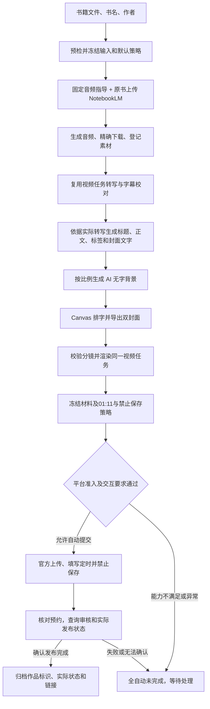
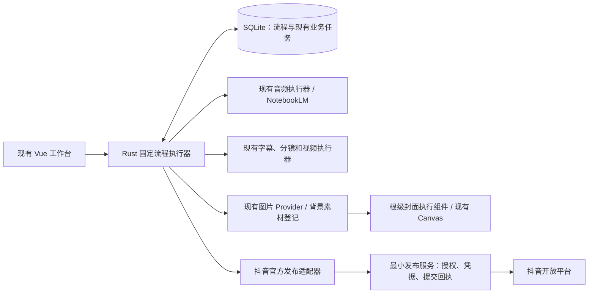

# 书籍到抖音全自动创作与发布计划

## 当前实施范围：最后一步由用户发布（2026-11-07 修订）

用户后续明确允许最后由本人点击抖音「发布」。本节优先于下方历史官方 API 方案：当前采用已有官方网页辅助发布，不再等待官方 API 准入，不新增发布服务或另一套发布通道。

固定流程：保存一个原书文件、书名、作者 → 一次启动 → 固定指导读取原书生成 NotebookLM 音频 → 原有转写、校对、分镜 → 从本次完整字幕生成文案 → 两种比例各一次 AI 背景 → 根级 Canvas 自动导出 → 原视频任务自动渲染 → 自动建立准确材料的发布任务 → 官方网页上传、文案、双封面、无合集、禁止保存与北京时间未来01:11 → 等待用户检查并点击发布。

首次配置包括文本/图片模型、视频环境、NotebookLM 登录和当前抖音窗口账号核对。自动采用和计划内模型调用在启动前明确授权；任务冻结本次账号，不能换号继续。登录、验证码、页面改版、已有草稿、处理状态不可核实或定时被平台调整等仍作为异常暂停；平台声明由用户在最终发布前按实际内容处理。

新增 schema v20 固定流程表，子任务与流程关联在同一事务保存。根级组件支持切页制作封面；旧手动任务继续原确认。暂停阻止新阶段并暂停音频/视频后续工作，已发出的单次模型请求允许结束并保留成果；停止通知全部子任务，不代表撤回已经发出的远端操作。外部失败不自动重发，明确重试才再次调用。

自动自检以本次完整输入快照为依据，不伪造人工确认。文案绑定实际音频指导与视频计划摘要。上传跨过候选01:11时，仅在尚未交接最终发布且策略一致时续算同一任务，任务包与网页快照同步；交接后不自动改期。平台决定预约范围，不接受则暂停，不降为立即发布。

当前完成边界是「准备完成，等待用户发布」；实际成功继续原结果记录，不将上传/预约/审核中计为已发布。最新验证见 [实施验收](AUTOMATION-VERIFICATION.md)。下方 P0–P4/A1–A20 为历史官方接口无人值守方案，不作为当前网页路线全部通过的声明。

## 历史方案：官方接口无人值守路线

日期：2026-11-07。状态：已进入 P0 核验，功能尚未实施。代码基线：应用 0.51.1，SQLite schema v19。

实施启动进展（同日）：已按用户要求进入 P0 官方能力核验，当前代码与公开接口核验见 [P0 记录](BOOK-TO-DOUYIN-P0-VERIFICATION.md)。全自动发布尚未实现，实际账号授权、原生预约、设置回读及最终发布核验通过后才能完成 P0；本文后续阶段与验收标准继续有效。

本次默认值修订：封面使用 AI 背景图；抖音按北京时间凌晨 **01:11** 定时发布；**不允许保存视频**。下述流程、数据快照、成本与验收统一采用这三个默认值。

## 1. 目标与推荐结论

用户日常只需要选择一本书的文件、填写书名和作者，点击一次「自动制作并发布」。系统完成原书处理、音频生成、字幕、标题与发布文案、封面、视频渲染、发布检查、抖音提交和结果归档。

**最终交付标准：前期配置完成后，每本书启动一次，正常流程直到作品实际发布并归档，全程零人工点击、零中途确认。** 不得在中间要求用户采用AI背景、确认分镜、点击继续渲染、再次允许付费、确认上传、点击最终发布或手动记录发布结果。可选预览与用户主动暂停不属于必经步骤。

**推荐：在现有 NotebookLM 音频和本地手绘视频上增加一条固定的持久化流程；正式自动提交只接已获准的抖音官方发布能力。先验证发布准入，再实施整条链路。**

这条路线复用最多现有代码。首版不建设通用工作流编辑器，不引入第二套视频引擎，不同时接多家音频服务，也不以浏览器自动点击最终发布作为官方接口的替代路径。

需要区分两个交付结果：

- **自动制作完成**：已生成音频、字幕、标题、文案、封面和可用 MP4，是阶段成果；这一部分通过不代表本次全自动发布目标完成。
- **全自动发布完成**：取得适用权限、授权有效、平台允许该交互模式，且作品最终状态通过官方渠道核实。仅上传成功或拿到作品标识不等于完成。

本次需求是对旧版本「分步创作、人工确认分镜、人工最终发布」的新增规划。本文不宣称当前应用已有该能力，也不把项目原有边界当作不能规划新功能的理由。

## 2. 产品范围与使用体验

### 2.1 一次性准备

以下事项在首次配置或授权失效时处理，不要求每本书重复填写：

1. 配置现有文本模型与图片模型，完成 NotebookLM 登录，确认当前网站和账号可以生成并下载音频。
2. 使用现有视频环境检查，确认 Node、Python、本地识别模型、FFmpeg、浏览器、字体和 Frametell 可用。运行时交付与许可沿用现有独立安装约定。
3. 绑定已获准使用的抖音账号，完成平台规定的授权；检查发布和结果查询权限，验证服务端配置。
4. 保存一份默认创作配置：节目格式、目标时长、已有手绘风格、封面样式和发布账号；默认启用 AI 背景图，发布模式为定时、北京时间 01:11，允许保存视频关闭。新自动任务从这份配置创建独立快照。
5. 明确原书将发送至 NotebookLM、音频转写将发送至已配置文本模型、背景画面提示词将发送至图片模型、成片将发送至抖音，并一次保存自动生成、采用结果、渲染、定时提交和费用/次数上限的授权配置。每本书的一次启动按该配置冻结许可，默认包含两种尺寸各一张背景；预算内的计划调用不中途再次询问，超预算或额外收费重做才进入异常处理。

自动发布开关只有在平台准入验证通过后出现可用状态。若平台对获准路线仍要求逐作品人工预览或确认，该路线就不满足本次全自动目标，P0应明确未通过；不能用一次性开关冒充平台认可的永久确认，也不能将半自动交付算作本需求完成。

### 2.2 每本书的正常操作

```text
选择书籍文件 + 填写书名、作者
  → 点击「自动制作并发布」
  → 自动生成音频、文案、AI 背景封面和视频并检查
  → 自动填写未来日期的北京时间 01:11，自动关闭允许保存视频
  → 自动提交获准的定时发布流程并核对设置
  → 自动等待预约时间及审核、查询实际结果
  → 自动记录发布结果，显示作品链接和全部本地产物
```

用户可以切换书籍、查看其他页面或最小化主窗口。流程卡只展示真实阶段、已有产物、错误原因和「暂停 / 继续 / 停止」。不再要求逐项挑音频、挑视频、选文案版本或导出封面；流程固定使用本次任务产生的准确 ID。

**无人值守的适用条件**：制作和提交期间 Windows 应用保持运行，电脑不睡眠，网络、网站会话和官方授权有效，输入文件及生成内容通过检查，平台允许免逐次确认并支持所需定时及保存权限。登录、验证码、来源无法解析、质量检查失败、提交结果不明时暂停并保留成果。完全退出应用或关机后，本机步骤不会继续执行；平台已确认受理的预约由平台执行，本地重开后核对结果，不重复提交。

### 2.3 首版默认范围

| 项目 | 推荐首版范围 | 原因与取舍 |
| --- | --- | --- |
| 运行平台 | Windows，单个活动流程 | 现有音频和视频自动任务按 Windows 实现，避免扩大验证面 |
| 输入 | 每次一本、一个本地原书文件 | 支持范围取本地接收格式与 NotebookLM 当时可用格式的交集；优先验收 EPUB、文字 PDF、TXT/Markdown，再验收 DOCX |
| 文件例外 | 扫描版、加密或 DRM 文件不能解析时暂停 | 首版不新增 OCR、解密、自动找书或整套本地电子书解析器 |
| 音频 | 复用 NotebookLM 现有格式及下载流程 | 目标时长是指导，主持人数和实际时长以产物为准；不把提示词当作严格控制能力 |
| 默认时长 | 建议目标 10 分钟，设置时可调整 | 当前官方错误码列出 15 分钟上限；以实际音频/成片时长预检，不能仅检查提示词目标 |
| 视频 | 现有 16:9、1920×1080、24fps 手绘 MG | 已有渲染与字幕体系；9:16 需另做构图验收，不把横屏强裁切伪装成适配 |
| 封面 | 默认使用 AI 背景图，生成 4:3、3:4 两张封面 | 两种比例各生成一张无字背景，复用本地模板和 Canvas 排中文字；需配置现有图片 Provider |
| 发布时间 | 默认定时发布，北京时间凌晨 01:11 | 自动确定满足平台预约窗口的未来日期，保存完整时间；不能转为立即发布 |
| 保存权限 | 默认不允许保存视频，即 `allowDownload=false` | 提交前和平台受理后均须核对；这是抖音观众保存权限，本地 MP4 仍正常归档 |
| 账号与平台字段 | 一个已绑定账号，按冻结的定时与保存设置提交 | 必须验证定时、禁止下载、封面和 AI 标识的实际支持，不照搬网页字段 |
| 扩展 | 批量多书、多账号、关机继续制作、独立云端定时器后续评估 | 首版由平台执行已受理预约，不再建设第二套定时发布路径 |

### 2.4 日期计算与默认值生效规则

- 时区固定为 `Asia/Shanghai`（UTC+08:00），不随电脑时区改变。01:11 表示本条作品的目标发布时间，不代表每天自动重复发布。
- 在材料全部就绪、首次创建发布快照时，选取**最近一个满足平台最小提前量及最大预约范围的未来 01:11**，展示完整日期。例如北京时间 2026-11-07 10:00 就绪时，若平台允许，应预约 2026-11-08 01:11；若当天 00:30 就绪但剩余时间不足官方最小提前量，同样选择下一天。无法核实预约窗口或没有可选日期时等待处理。
- 保存为既有 `scheduled_at` 格式，例如 `2026-11-08T01:11:00+08:00`；`allow_download=0`。这两个任务字段沿用现有保存、快照、任务包与备份机制，不新增一份相互可能冲突的任务发布模式。
- 默认配置只是新自动任务的初值，允许用户在开始前修改，保存后冻结。本次默认修订不批量改写旧任务或已提交作品，也不改变旧数据库迁移的默认值。
- 默认冻结的是「最近有效的未来01:11」策略。上传完成后、首次平台创建意图落库前再次核算日期；若原候选时间已失效，且能证明本地和服务端都没有创建意图或创建调用，自动更新同一任务为下一个有效01:11，记录原因，无需用户确认。这是执行预设策略，不是重新发布。
- 一旦创建意图落库，具体日期与请求内容即冻结。已经提交、结果未知或平台调整后的时间不得自动改期再发；先核对原预约，无法确认则暂停。用户在前期明确指定的绝对日期也不得被自动替换。
- 优先填写并提交平台原生定时发布设置。官方 API 的定时能力目前尚未核实；若不能表达并核对这三个默认要求，全自动准入与最终验收均不通过。现有辅助发布仅可由用户主动选择作为应急方式，不自动切换，不用本机等到01:11再调用立即发布来冒充平台定时。

### 2.5 正常流程的人工操作核对表

| 环节 | 自动模式应执行的动作 | 启动后是否需要用户操作 |
| --- | --- | --- |
| 音频 | 上传绑定原书、填写固定指导、生成、等待、下载、校验并关联音频 | 否 |
| 文案 | 从实际转写生成标题/正文/标签/封面提示词，校验后保存并采用本次版本 | 否 |
| AI封面 | 按配置生成两张背景、自动采用、Canvas排字、导出并绑定封面 | 否 |
| 视频 | 转写、校对、分镜检查通过后直接启动渲染，登记本次成片 | 否 |
| 发布准备 | 自动建立发布任务和材料快照，选定本次音视频/文案/封面，执行策略校验 | 否 |
| 发布设置与提交 | 使用预绑定账号、自动确定01:11日期、禁止保存、设置声明并提交平台预约 | 否 |
| 等待与归档 | 等待生成/上传/预约/审核，自动查询并保存实际发布记录与链接 | 否 |

只有登录或授权需要重新处理、验证码、质量校验失败、额度不足、无法恢复的错误、外部提交结果无法核实等异常才通知用户。正常的服务等待、预算内收费调用、平台审核等待和可续期Token刷新均自动处理，不弹确认，也不要求点击「继续」。

## 3. 当前真实能力与缺口

以下根据当前源码核对；旧文档中的规划接口不等于已经存在的实现。

| 环节 | 当前实现及代码依据 | 需要补齐 |
| --- | --- | --- |
| 建书和关联文件 | [projects.rs](../src-tauri/src/database/projects.rs) 的 `save_project_with_documents` 原子保存书籍与来源关联 | 增加保存后创建自动流程的入口，原文件仍不改写 |
| 原书读取 | [note_import.rs](../src-tauri/src/note_import.rs) 仅把 TXT/Markdown 读成资料；[database/ai.rs](../src-tauri/src/database/ai.rs) 的 `prepare_generation` 发送书名、作者、简介、资料文本 | 绑定 PDF/EPUB 不代表文本模型读过原书。首版由现有 NotebookLM 来源上传承担原书解析 |
| 文案生成 | [ai_commands.rs](../src-tauri/src/ai_commands.rs)、[ai/publishing.rs](../src-tauri/src/ai/publishing.rs) 已有统一 Provider、结构校验、标题、标签及封面文字 | 自动流程的最终文案输入改为实际音频转写；不从书名猜章节、观点或名句 |
| 音频 | [audio_commands.rs](../src-tauri/src/audio_commands.rs)、[audio.rs](../src-tauri/src/audio.rs)、[database/audio.rs](../src-tauri/src/database/audio.rs) 已能创建笔记本、传来源、生成、下载、归档 | 当前 `StartAudioJobInput` 必须引用已保存文案；需支持自动流程的固定指导快照，并接通完成后的下一步 |
| 封面 | [coverRenderer.ts](../src/services/coverRenderer.ts) 是现有唯一 Canvas 排版器；[CoversPage.vue](../src/modules/covers/CoversPage.vue) 负责当前交互与导出；[cover_commands.rs](../src-tauri/src/cover_commands.rs) 已有 `start_cover_generation` / `execute_cover_generation` 和统一图片 Provider | 自动生成并绑定两种比例的背景，脱离封面页挂载调用同一排版器，导出并登记；复用现有能力，不增加第二套图片接口 |
| 视频 | [video_commands.rs](../src-tauri/src/video_commands.rs) 的 `execute` 完成字幕、校对和分镜后进入 `awaiting_confirmation`；渲染另行启动 | 在自动流程授权及检查通过时继续同一视频任务；手动任务继续保留人工确认 |
| 本地发布准备 | [database/publishing.rs](../src-tauri/src/database/publishing.rs) 已有快照、自检、任务包及发布记录 | `checked` 依赖 `title_confirmed` / `covers_confirmed`；必须区分人工确认与自动策略校验，不能伪造勾选 |
| 抖音操作 | [douyin.rs](../src-tauri/src/douyin.rs)、[douyin_flow.rs](../src-tauri/src/douyin_flow.rs)、[douyin_editor.js](../src-tauri/src/douyin_editor.js) 为官方网页辅助填写 | 没有已实现的官方自动发布 Provider，也没有官方回执和审核状态闭环 |
| 任务连续性 | [generation.ts](../src/services/generation.ts) 支持当前应用会话内离页生成；[workflow.ts](../src/services/workflow.ts) 提供续作入口 | 尚无跨音频、视频、封面和发布的持久编排；应用重启不能直接视为可继续外部写操作 |

现有音频、视频任务均限制活动任务数量。自动流程应遵守原限制；其他书籍有未处理音频任务时提示处理，不擅自取消它来抢占运行位置。

## 4. 抖音自动发布的可行性门槛

这是第一阶段必须完成的验证，不安排到全流程开发的最后。

### 4.1 必须核实的事项

截至 2026-11-07，从当前官方正文能核实的情况如下；它们是公开文档证据，不是本项目账号的实测结果：

| 公开依据 | 对本方案的具体影响 |
| --- | --- |
| [新版创建视频][D1] 为 `POST /api/douyin/v1/video/create_video/`，要求 `video.create.bind` 和用户授权，需在能力实验室申请「代替用户发布内容到抖音」 | P0 核实这个具体能力，不能把旧 `video.create` 或网页登录成功当作已授权 |
| [新版上传视频][D2] 同样使用 `video.create.bind`；超过 50 MB 建议分片、超过 300 MB 必须分片，总大小在 4 GB 内，错误码列有 15 分钟限制 | 首版统一使用分片上传路径，并验证所需分片端点和续传语义；不沿用旧文档的 128 MB 阈值 |
| [创建视频][D1] 中 `text` 包含内容与话题，合计上限 1000 字；`custom_cover_image_url` 实际填写图片上传取得的 `image_id` | 标题、正文和标签合并后再做平台长度检查；封面不能直接传本地路径或凭字段名传任意 URL |
| [创建视频][D1] 的完整请求结构已核实 `download_type=1` 表示作者不允许下载、`0` 表示可以下载；未找到定时、AI 声明及独立双封面字段 | 禁止保存可映射为 `1`，仍须验证受理后的设置回读及平台原生定时提交/查询能力；01:11 定时和禁止保存是首版必需项，不自行添加请求参数。完整结构证据见 [P0 核验](BOOK-TO-DOUYIN-P0-VERIFICATION.md) |
| [授权说明][D3] 给出 access token 15 天、refresh token 30 天，且续期有总时长限制；[令牌接口][D4] 需要应用 Secret 并建议服务端保管 Token | 以响应有效期安排续期，序列化同一账号刷新；不能承诺第一次授权后永久不用再登录 |
| [发布能力规范][D5] 的 SDK/H5 方式明确要用户手动发布 | SDK/H5 不满足本目标；该表未清楚解释能力实验室 `video.create.bind` 的适用主体与逐次确认规则，必须单独核实，不能直接套用或反向推定允许 |
| [创建视频][D1] 说明创建后会审核，审核期间仅自己可见 | 接口成功、`item_id` 或 `video_id` 都不是公开发布完成证据 |
| 名为[查询视频发布结果][D6]的文档实际是分享 SDK 的 `share_id` 机制；[视频基础信息][D7]另需 `posting.behavior`，本次正文未明确状态枚举 | 不能仅凭页面名称直接接成审核查询。拿到适用于本应用的查询/事件权限并实测语义，是全自动闭环的必要条件 |

官方上传页对比例的文字描述存在不一致，本计划不据此推导横竖屏限制，16:9 成片须通过实际上传验证。发布频率和每日额度也应读取实际应用权限；不把文档错误码中的默认数字当成账号承诺。

**已发现的真实适配风险**：项目历史 NotebookLM 验收样本为 16 分 39 秒（见[音频验收](IN-APP-AUDIO-VERIFICATION.md)），超过上述文档所列 15 分钟。目标 10 分钟的提示词不能证明输出必定合规。P0 必须验证短期节目配置，过长时保留音频并暂停；首版不自动切断节目、改变语速或重新付费生成来掩盖超限。

| 验证项 | 通过所需证据 | 未通过时的产品行为 |
| --- | --- | --- |
| 应用资格 | 当前开发者主体、应用类型与场景可以申请目标能力 | 不开放「全自动发布」 |
| 用户授权 | 官方 OAuth 流程、实际获批 scope、账号稳定标识及续期方式 | 等待授权，不以网页昵称或已登录代替接口授权 |
| 上传与创建 | 用授权测试账号完成一次合法素材上传和创建，确认接口当前可用 | 保留本地产物，停在发布前 |
| 无人值守交互 | 对当前应用适用的规范允许该模式，或获得平台明确确认 | 若必须逐次人工预览/确认，全自动目标未达标，不能以确认发布替代验收 |
| 输出字段 | 明确正文/话题、自定义封面、可见性、合集和 AI 标识的支持范围 | 不支持的必填能力直接阻止，不能静默忽略设置 |
| 01:11 定时与禁止保存 | 平台接受完整北京时间预约值和禁止下载设置，能够回读核对；核实最小提前量、最大预约范围及改期语义 | 创建意图前失效按默认策略重新求有效日期；缺能力、已提交后过期、平台调整或回读不一致均暂停，不转为立即发布或允许保存 |
| 完成语义 | 能区分已上传、创建已受理、处理中、审核结果和可见状态 | 证据不足保持「待核实」，不能写 `published` |
| 限额 | 当前应用和账号的文件、时长、调用频率及每日额度 | 启动前预检；平台限额变化按实际错误处理 |

公开接口存在不能证明本项目、普通个人主体或当前账号一定能获批。权限申请等待时间不计入研发工期。

### 4.2 与现有网页辅助发布的关系

官方 API 适配器负责新自动流程的提交和查询。现有网页辅助发布保留给原手动任务；同一发布任务在首次外部提交前锁定发布通道。官方提交结果不明时不能自动切换网页再发一次。

首版不新增读取 Cookie、调用网页私有发布接口或自动点击最终发布按钮的实现。原因是这些方式不能解决当前最关键的授权、平台交互要求、回执查询和重复提交问题，且会增加第二条自动发布路径。

### 4.3 官方提交的固定顺序

1. 预检当前授权、账号和已获准能力；将本地标题、正文、标签合并为平台 `text` 后检查总长度。超限暂停，不从末尾静默截断。
2. 通过已核验的分片协议上传本次 MP4，记录实际上传标识和分片进度。分片失败按官方续传协议处理，上传完成本身不创建作品。
3. 调用[图片上传][D8]取得 `image_id`。首版拟选用本地 3:4 作为官方单封面，P0 必须验证采用结果；4:3 留在本地任务包。配置界面明确这一差异，不宣称 API 已同时设置横竖两张封面。
4. 上传就绪后按第2.4节自动核算最终预约日期，将北京时间01:11、不允许保存视频、可见性及平台要求的AI内容声明写入请求。禁止保存按P0已核实的公开契约使用 `download_type=1`，受理后仍须回读；定时或AI声明没有获准的表达方式时，停在发布前。
5. 提交前再次检查时间有效及保存权限，将完整请求与创建意图持久冻结后，只发出一次本次定时创建请求。自动保存响应标识和受理状态，并回读定时及禁止保存设置；回读不一致时停止后续推进，不再新建作品。正常提交和回读不要求用户点击确认。
6. 显示「已预约，等待北京时间 YYYY-MM-DD 01:11」，使用 P0 验证通过的查询或回调确认预约、处理、审核和可见状态。[Webhooks 文档][D9]给出的通用验签与重投机制不能证明当前已获准审核事件，不能根据事件名称猜用途。
7. 自动核对账号、作品和内容绑定后写入发布记录、实际时间及链接，不要求人工「记录发布成功」。默认目标是公开作品；预约已受理、时间到达、处于审核中或仅自己可见都不等于公开发布成功，仍需核实实际结果。

## 5. 一条固定的执行流程



### 5.1 原书与音频指导

- 书名和作者采用用户填写值，原书作为唯一指定来源，来源文件以素材 ID、字节数和 SHA-256 冻结。启动后文件改变不得偷偷换成新输入。
- 首版从现有音频模板复用固定开场、结尾、时长和五部分结构，形成通用的「严格依据所上传来源讲解」指导，以讲解和评论为主、仅有限引用，不生成整本机械朗读或搬运内容。读取原书前不让文本模型编造本书内容，也不先生成一套虚构标题来满足旧接口。
- 将 `database/audio.rs` 中「解析指导来源」与「建立并执行音频任务」分开：手动入口继续从文案版本取得指导；自动入口从已冻结的流程策略取得指导。二者进入同一个音频任务创建方法和同一份 `FrozenAudioInput`。已有可空 `writing_version_id` 能表达没有前置发布文案的情况。
- 新增独立版本的自动音频指导 Prompt；共享原有模板生成函数，避免复制开场、结尾和时间计算。当前书名、作者和文件内容均是数据，不可改变系统指令或触发任意工具。
- 等待网站明确完成来源处理后再提交一次生成；只有下载校验与 `assets` 登记成功才进入下一步。身份或提交结果未知时复用现有核对流程。

这是本方案减少复杂度的关键：使用已有服务对原书生成音频，随后从实际声音产生发布内容。代价是原书事实质量依赖 NotebookLM，本地转写只能证明「音频说了什么」，不能证明「原书确实如此」。试运行须另做来源对照；不能用 JSON 合法或音频可播放当作内容事实正确的证明。

### 5.2 字幕与最终发布文案

1. 用本次 `audio_asset_id` 创建现有视频任务，复用本地识别、原始字幕保存及校对；不另起第二次 ASR。
2. 在视频准备完成后，读取该任务已保存的实际转写与书名、作者，生成最终标题、正文、标签、封面文字及 4:3/3:4 背景图提示词。提示词使用同一风格与内容依据，为不同尺寸独立安排构图和文字留白；为新输入方式新增版本化 Prompt，继续复用同一 `TextProvider`、诊断、取消与结果校验。
3. 当前全量输出与音频指导耦合，需要按「发布字段」解析后合并已经冻结的音频指导，得到一份完整 `WritingContent::Publishing`。保留旧手动全量生成；不重新生成音频指导或覆盖已用指导来掩盖不一致。
4. 输入超出模型已验证的上下文预算时，按连续字幕分块提炼并保留 cue 引用，再生成最终内容；禁止静默截掉后半本内容。首版限制单期长度，只有确实超限才启用分块处理。
5. 最终文案保存为独立正式版本，并绑定本次音频、视频及流程 ID。后续封面与发布只使用这个版本，不使用「本书最新版本」这样的不确定查询。

文案检查覆盖标题长度、话题格式、未处理占位符、书名作者一致性和与转写的主题一致性。不生成没有依据的原文引语、销量、获奖信息或作者经历；检查不通过即暂停，不能无限请求模型直到出现一个“通过”。

### 5.3 AI 背景图与自动封面

- 默认启用 AI 背景，预检时要求图片模型已配置、启用且凭据可用。复用现有图片 Provider、`ai_tasks` 和背景素材登记，按 4:3、3:4 的冻结提示词各发出一次生成，依次执行，不额外生成不用于本次发布的 16:9 图片。
- 图片模型只生成无字背景；复用当前 `renderCover` 和 `cover_versions`，将对应背景与同一最终文案、默认样式合成两张封面，真实中文文字由 Canvas 绘制。
- 两种尺寸分别记录 AI 任务 ID、模型/提示词版本、返回的背景素材 ID 和摘要；本次策略明确允许自动采用校验通过的本次背景，仅作用于本次任务的对应尺寸，不覆盖原手动封面或其他尺寸。
- 将生成和导出调用从 `CoversPage.vue` 中提取到共享服务；在应用根级挂载一个封面任务执行组件，切页不会卸载。Rust 持有任务意图，根级组件只是调用唯一排版器的执行端。
- 组件启动时读取未完成任务快照，事件仅用于唤醒。回传必须包含流程 ID、运行代次和配置摘要；迟到结果不得写入其他任务。
- 图片按现有格式、大小及解码规则校验；等待字体与背景加载、检查安全区域及输出像素，再通过现有 Rust 导出保存。文件落盘和数据库登记成功才记录对应尺寸已完成；部分完成时复用已成功的背景与封面，避免重复收费或重复创建版本。
- 图片服务失败、预算不足、结果未知或素材丢失时暂停并保留成果，不自动切成纯色/模板背景。收费重做需要明确发起，不能因重启或切页重复请求；仅在开始前明确改选本地背景的任务才按本地配置执行。

该选择要求桌面主 WebView 存活，但无需用户打开封面页；它比新增 Rust 中文排版器或另带一个封面浏览器简单。

### 5.4 自动视频

- 继续使用本次 `video_jobs` 的音频、字幕和分镜；自动化只决定何时从准备进入渲染，不重复实现视频引擎。
- 自动策略通过后，调用原来的渲染业务方法。分镜覆盖全部 cue、物体/场景均在白名单、字幕时间有序、图片引用有效，才允许渲染。
- 继续执行现有严格布局和确定性检查，沿用运行代次、子进程树管理与缓存签名。模型只提供结构化分镜，不产生可执行 JS 或 Shell。
- 渲染结束检查视频可解码、有画面和音轨、音频与成片时长匹配、字幕覆盖和最终素材关联。不得仅凭文件存在或进度到 100% 判定完成。
- 只有本自动任务允许用策略检查替代应用内分镜确认；手动任务仍显示确认页，旧成片不被覆盖。

## 6. 最小架构与实现位置



### 6.1 本地执行器

建议新增 `src-tauri/src/automation.rs` 和 `src-tauri/src/database/automation.rs`，用固定阶段枚举推进。开始、暂停、继续、取消、读取快照是少量 Tauri 命令，业务逻辑留在 Rust。

现有 `ai_commands.rs`、`audio_commands.rs`、`video_commands.rs` 中被 IPC 参数包裹的业务调用，按需要提取为同模块内部函数，供 UI 与执行器共用；图片生成直接复用 `cover_commands.rs` 中已有的 `execute_image_task`。不要从 Rust 反向模拟 Vue 点击，也不要复制整份命令实现。

执行器负责阶段切换和任务绑定；音频、视频、AI 子任务仍是各自执行结果的权威来源。执行器不维护另一份转写进度、完整分镜、下载状态或媒体元数据。先按顺序运行，后续有实测性能瓶颈再考虑封面与渲染并行。

前端在现有书籍添加页、书籍详情和 `RunningTasks` 中接入流程卡；详细失败仍可进入原音频、视频、封面或发布页面修正。不另建一套编辑工作台。

### 6.2 官方发布服务

当前工程是桌面应用，没有可承担平台机密凭据的自有服务。若目标应用的官方 OAuth 需要 `client_secret`，正式发行版不得将共享 Secret 填进前端、安装包或普通配置。

推荐增加一个仅负责抖音接入的轻量服务：OAuth 回调、Token 交换/续期、账号绑定、受控上传/定时创建、查询及持久提交回执。视频制作继续在本地，不搬到云端，不新增消息队列或云端工作流；预约执行由已核验的官方定时能力承担，服务不另设到点立即发布的调度器。

- HTTPS 回调校验 `state`、一次性会话及用户归属；桌面仅接收本次绑定结果或短期服务会话，不把长期 Token 放在回跳 URL。
- `client_secret` 和平台长期凭据保存在服务端密钥设施或加密存储，日志脱敏。短期桌面会话沿用系统凭据库。
- 每次请求检查当前服务用户、绑定账号及本次发布快照。账号切换后旧任务必须重新核对，不能把作品发到新的默认账号。
- 上传统一采用分片流式转发，发布服务不永久保存整本书、音频或视频；P0 核验片大小、合并和恢复规则，完整记录平台上传会话。
- 服务端只保留必要授权信息和不可重复提交的回执台账；不复制本地书籍库及视频任务状态机。

这里的服务是新增运维成本。若无法维护这项服务或无法取得平台权限，只能证明自动制作阶段完成，本次全自动目标仍未完成；不能把应用 Secret 分发给所有客户端来省掉服务。

## 7. 状态、数据与恢复

### 7.1 流程表

建议增加一张 `automation_runs`，保存跨步骤必需的联系与策略，不引入通用节点表。

| 字段组 | 内容 |
| --- | --- |
| 身份 | `id`、`project_id`、`run_id`、创建与更新时间 |
| 进度 | `status`、`stage`、当前阻塞/错误代码与说明 |
| 输入 | 来源素材 ID、摘要、书名作者快照、默认配置及版本、目标账号、自动操作授权记录；配置包含 AI 背景模式、图片模型与额度、`Asia/Shanghai`、01:11 和禁止保存策略 |
| 子任务 | 本次文案与两种比例背景 AI 任务、音频、视频、发布任务 ID；必要的正式文案、背景素材及封面 ID |
| 校验 | 校验策略版本、检查结果及所绑定的输入/产物摘要 |

`status` 建议为 `queued / running / waiting_user / reconciling / succeeded / failed / cancelled`；`stage` 表示当前业务步骤。`reconciling` 表示外部操作可能已成功，正在查询，不能据此重新提交。

默认配置复用 `app_settings` 存储，新自动任务冻结策略；具体预约日期只以该发布任务的 `scheduled_at` 为权威值，创建意图落库前可按默认策略重新求值，之后不可自动变更。已预约等待属于远端状态，不另建本地定时任务表，也不因等待时间长将流程判为失败。

为启动请求设置唯一标识；双击开始、前端重挂载和重复消息返回同一任务。流程创建子任务与保存子任务 ID 应处于同一事务，先登记再执行外部操作，避免崩溃后凭空再建一个音频/视频任务。

### 7.2 发布数据

复用 `publish_tasks` 和 `publish_records`，按实际获准接口补充：通道、稳定账号 ID、不可变提交键、上传标识、作品标识、远端状态、最近查询时间、受理时间及失败信息。平台返回的 ID 按字符串保存，不按本地整数假设。

- 本地 `draft / ready / published` 继续表示材料与归档状态；新远端状态表达提交、已预约、审核和可见事实，界面不能把已预约或待审核任务显示成已经发布。
- 将现有标题/封面人工确认与自动策略校验分开记录。自动任务只有在绑定的策略和完整内容摘要一致时才能通过自检；不得把 `title_confirmed` / `covers_confirmed` 自动写成“用户已检查”。
- 新自动任务显式写入 `allow_download=0` 和按第 2.4 节计算的完整 `scheduled_at`，不能依赖旧迁移中的 `DEFAULT 1` 和 `NULL`。默认偏好与任务快照分开，编辑偏好不改旧任务；这两个字段无需为新增默认值重复建列。
- 原任务的 `allow_download`、`scheduled_at`、合集和双封面要求不能默默丢弃。只有通过验证的通道字段才能使用；旧定时任务不得自动转换成即时发布任务。请求回执必须能核实禁止保存和完整预约时间，未核对前不能显示预约成功。
- 官方成功回执与本地发布记录、书籍状态在同一事务落库；没有官方作品链接时留空并显示真实标识，不能拼凑链接或伪造发布时间。

当前最新迁移为 `0019_editor_owners.sql`。实施时新增后续兼容迁移，编号以当时分支为准；本轮不创建 SQL、不修改正式数据库。

### 7.3 防重复发布

1. 创建本地发布任务时分配不可变 `submission_key`；上传前冻结账号、成片SHA-256、文案、封面摘要、01:11策略及 `allow_download=0`。上传完成后、平台创建意图落库前核算最终 `scheduled_at`，将完整请求摘要与创建意图一起持久化；无创建意图时重新求日期继续使用同一个key，不新建任务。
2. 同一 key 在本地及发布服务均唯一。同一账号、同一成片的再次创建先查已有回执，即使仅改了文案也不能在未知状态下再发。
3. 服务端接收请求先持久记录提交意图，再发出平台创建请求；收到作品标识立即持久化后才回复桌面。重复桌面请求返回既有回执。
4. 平台受理后网络中断，或服务端在收到响应前崩溃，可能无法知道平台是否已创建；若官方没有幂等键或可核对查询，保持 `reconciling / waiting_user`，禁止自动再发。不能声称数据库唯一索引能保证跨网络绝对“恰好一次”。
5. 有可靠作品标识时只查询该作品。不得凭标题相同、最近一条作品或列表排序猜测发布结果。
6. 收到重复回调、轮询重复结果或保存重试只更新同一回执，不新增作品或发布记录。签名与回调能力仅在官方支持且验证后启用；首版以已核实的查询方式为准。

### 7.4 暂停、重启与错误处理

| 场景 | 恢复方式 |
| --- | --- |
| 切换页面、切换书籍、最小化 | 根级执行组件与 Rust 任务继续；前端从数据库重新读取同一快照 |
| 用户暂停 | 停止开启下一阶段，打断可取消的本地工作；远端生成或已受理发布可能继续 |
| 用户停止 | 不再推进或提交新动作，保留产物；已有提交仍保存并核对结果，停止不等于撤稿 |
| Token正常到期且仍可续期 | 服务自动串行刷新并继续原任务，不要求用户确认 |
| 登录失效、授权撤销或刷新失败 | 等待官方重新授权，随后核对原账号和原任务，不更换账号继续 |
| 音频提交结果未知 | 核对原笔记本及远端音频，不重新生成；已有下载可继续归档 |
| AI 超时或不合法结果 | 保留成果并停止该步骤；单次文本请求沿用当前 300 秒限制，不将整条流程限制为五分钟 |
| 某一比例背景生成或封面导出失败 | 保留另一个比例及已成功背景，只重做明确失败部分；生成结果未知不自动重发，不改用纯色背景 |
| 只读查询暂时失败 | 遵循平台限流信息，有限退避，达到上限后暂停；不对创建/生成接口套同一重试器 |
| 渲染失败或退出 | 复用已保存字幕、分镜和满足摘要的缓存；重启先完成子任务原有恢复，再由流程认领 |
| 来源或产物被修改 | 摘要失效，停止受影响步骤；保留旧版本，明确重做范围 |
| 默认候选时间失效，且本地/服务端都能证明尚无创建意图或调用 | 自动计算最近有效的未来01:11，更新同一任务并继续，无需再次点击 |
| 创建意图已落库后时间过期、被平台调整或提交结果未知 | 暂停并核对原预约，等待明确处理，不顺延后重新投稿 |
| 官方保存权限无法核对或变成允许保存 | 保留任务并等待处理，不将该项标为通过，不自动再次创建作品 |
| 平台已确认受理定时发布 | 显示完整预约日期和北京时间01:11，平台到点处理；本地退出不新建预约，重开只查询原作品 |
| 平台审核中 | 低频查询，不重复上传；应用关闭后平台审核可能继续，重开再查询 |
| 审核不通过 | 记录原因和已生成产物，等待处理；不自动换标题反复投稿 |
| 从备份恢复 | 保留作品标识和提交键，先重绑凭据、查询远端；不得自动重放已有发布或生成意图 |

第一次实现不承诺任意崩溃点都能无人干预续跑。可证明未执行的本地步骤可自动恢复；涉及外部副作用且结果不明时需要核对。这是全流程可靠性的组成部分。

## 8. 分阶段实施与退出条件

以下为单人开发的初步工作量估算，基于复用现有模块；不含平台审批、服务采购等待或无法预知的网页改版。

| 阶段 | 工作内容 | 可交付结果与退出条件 | 预估 |
| --- | --- | --- | --- |
| P0 可行性验证 | 核对官方资格、scope、交互规范、原生定时和禁止下载及查询；验证 NotebookLM、图片 Provider 和视频运行环境 | 形成能力矩阵和授权测试作品的真实回执，含01:11预约与禁止保存回读；明确是否允许无人值守，未通过不宣称全自动可用 | 2–4 人日，审批另计 |
| P1 自动音频与持久编排 | 书籍三项输入、默认策略、流程表、固定指导、现有音频任务衔接、活动任务与停止恢复 | 从一本书自动得到唯一有效音频及持久任务；无重复生成 | 3–5 人日 |
| P2 自动成片与材料 | 复用转写校对/分镜；基于转写生成发布内容及背景提示词；两比例AI背景、根级排版导出、自动渲染与绑定 | 无逐步点击得到音频、SRT、MP4、AI背景双封面和文案；图片失败保留成果，不重复收费 | 5–7 人日 |
| P3 官方发布闭环 | 最小服务、授权续期、01:11预约日期计算、禁止保存、固定快照、提交台账及结果核对 | P0 获准场景下完成真实定时提交、设置回读和实际发布核对；过期/设置冲突不误发 | 5–9 人日 |
| P4 稳定性与交付 | 中断/重复/恢复、三本书试运行、升级与备份、桌面交互、文档 | 达成下表验收；明确支持格式、账号、平台和剩余限制 | 3–5 人日 |

加入 AI 背景与必需的定时、禁止保存验证后，总计约 **18–30 人日**。这是评估范围，不是对审批时间、视频生成耗时或平台审核时间的保证。P0 不通过时，可保留P1/P2阶段成果，但本次全自动发布需求保持未完成；不能自行降级成需要用户最终点击的流程并报告交付完成。

## 9. 验收标准

| 编号 | 验收场景 | 必须观察到的结果 |
| --- | --- | --- |
| A1 | 首次配置已完成，输入文件、书名和作者后开始 | 自动采用AI背景、北京时间01:11定时和不允许保存默认值，不再逐项选择素材；显示完整预约日期 |
| A2 | 三本有使用权限、类型不同的真实书籍 | 原书可处理，音频可播放，文案与实际音频一致；抽查来源事实及完整观看/听审结果单独记录 |
| A3 | EPUB、文字 PDF、TXT/Markdown 和 DOCX 分别测试 | 只将实际通过的格式列为支持；扫描/加密/空文件明确失败，不生成虚构内容 |
| A4 | 封面页从未打开，运行中切页/最小化 | 两比例AI背景生成并正确绑定；两张封面中文由Canvas排版、尺寸正确，背景和正式版本可追溯 |
| A5 | 分镜准备与渲染 | 自动任务检查通过后自然渲染；人工任务仍保留确认；画面、字幕、原声及最终文件一致 |
| A6 | 双击开始、重复事件、同一步骤返回两次 | 同一逻辑任务和同一产物，不重复音频生成、导出登记或发布 |
| A7 | 在音频生成、渲染、上传及平台创建后分别断网/退出 | 已完成成果保留；远端未知时查证或等待，尤其不能第二次创建作品 |
| A8 | 账号退出、更换账号、权限撤销、Token 续期失败 | 任务明确暂停，不发到另一账号，不泄露凭据 |
| A9 | 平台接口受理、已预约、处理中、审核拒绝和最终可见 | 各状态区分；到达01:11也要核实实际结果，不能把预约受理或接口200当作已公开 |
| A10 | 原书/音频/视频在开始后被替换，或用户修改文案 | 绑定摘要失效，重新检查；不发布混合版本 |
| A11 | schema v19 升级、备份恢复、再打开 | 旧书籍、文案、封面、音视频、人工发布记录保留；恢复不自动重放外部提交 |
| A12 | 新安装及环境缺失 | 首次引导明确缺项；环境检查通过后可完整运行，不要求每本书重复配置路径 |
| A13 | 平台不允许免逐次确认 | 全自动准入及最终验收均未通过；不能将人工点击发布作为本需求完成条件 |
| A14 | 未配图片模型、图片失败、单比例成功及重启恢复 | 启动前明确缺项；成功背景保留、不重复请求，失败不静默改为纯色封面，费用与次数可追溯 |
| A15 | 当日01:11前后、跨日/月/年、设备时区不同和平台提前量限制 | 选中最近有效的北京时间01:11，完整日期与存储值一致；无合法预约窗口时暂停 |
| A16 | 本地禁止保存、定时设置提交及平台回读 | `allowDownload=false`、具体预约日期和01:11全部匹配；控制不可用或冲突不得通过，未知枚举不猜值 |
| A17 | 上传期间候选预约失效、平台改期、已预约后退出/恢复 | 证明尚无创建意图/调用时自动求下个有效01:11并继续；已提交或未知时核对原作品，不改期重发，不变成立即发布 |
| A18 | 默认值编辑、旧任务打开及备份恢复 | 新自动任务采用冻结默认，旧任务设置不被重写；恢复保留AI背景引用、禁止保存和完整预约时间 |
| A19 | 前期配置齐备，用三本有效书籍分别启动一次，此后不点击任何按钮 | 每本书完整经过音频、文案、AI封面、视频、定时提交、实际发布核验和归档；中途人工操作数为0，不能用脚本替人点击确认来冒充通过 |
| A20 | 预算内图片生成、正常Token续期、服务等待和平台预约/审核等待 | 自动收费调用、续期和跟进；没有二次授权弹窗或「继续」按钮门槛，不把正常等待当异常中止 |

自动化验收分三层留证：本地契约/单元测试、Windows 真实应用与渲染、授权账号真实服务/作品。模拟页面、假 API 回执、短样片或本地 HTTP 夹具不能代替真实音频生成、完整成片或平台发布验收。

实施后按改动执行现有 `npm run lint`、`npm run typecheck`、`npm test`、`npm run test:rust`、`npm run check:rust`、`npm run build`，新增迁移/恢复与提交故障用例；发布服务另有契约检查。本文列出的是后续验证要求，不是本轮已执行结果。

## 10. 成本、取舍与待定事项

单条作品的成本由「文本模型输入/输出 + 两张 AI 背景图 + NotebookLM 对应订阅或额度 + 本地识别/渲染时间、电力与磁盘 + 发布服务和传输」组成。默认 4:3、3:4 各生成一张背景，沿用本地 Canvas 排字，不单独为文字排版调用图片模型。

不提前编造“每本几分钱”或“几分钟必完成”。P0/P2 用三本真实样本记录 token、图片次数/规格/实际计费、音频等待、渲染墙钟时间、成片大小和配额，再形成预算。能拿到真实用量时记用量，拿不到时显示未知，不把估算当账单；未知图片价格时只能限制调用次数，不能宣称已保证金额上限。生成、发布副作用默认不自动重试；收费重做需重新明确发起。

本轮的确定取舍：

- **复用现有音频服务**，减少实现和迁移量；接受其网页会话及内容质量限制，不承诺全天候服务等级。
- **从实际音频生成最终文案**，避免文案与节目脱节；原著事实核验仍需要试运行抽查，不能把转写当独立证据。
- **AI 背景配合本地模板排字及现有横屏视频**，复用现有图片Provider，增加两次背景生成成本；多音色、竖屏和批量运营留待后续。
- **官方接口定时发布并禁止保存**，默认北京时间01:11，由平台执行已受理预约；增加一个最小服务及审批成本，且必须核实定时、保存权限和交互要求，不以到点调用立即发布替代。
- **只增加必需的流程记录**，既有任务继续管各自业务；不引入 Redis、分布式队列、可视化节点编排或第二套状态管理。

进入实施前仍需由 P0 得到实际结论：当前主体与应用能否获批；是否要求逐作品用户确认；原生定时预约、禁止保存及回读方式；账号实际限额；当前 NotebookLM 的格式/单期长度和图片模型两种比例的可用范围；发布服务的域名和部署位置。技术库和版本在该阶段核对当时官方文档与源码后确定，本计划不预先增加依赖。

## 11. 影响范围与文档维护

预计涉及的模块：

- 新增固定流程服务、数据库迁移与对应测试；前端新增流程类型/服务及根级执行组件。
- 调整现有书籍入口、全局运行任务、音频创建契约、视频阶段衔接、文案/背景提示词输入、图片生成衔接、封面导出和发布自检。
- 新增官方发布适配及最小服务，补齐01:11完整日期计算、禁止保存默认值、平台回读和预约状态；只有具备能力的任务进入该通道。
- 扩展现有备份恢复以保留流程关联和提交回执；凭据继续不进入普通备份。
- 实施时同步 `PRD.md`、`TECHNICAL-DESIGN.md`、`DATABASE.md`、`AI-RULES.md`、`USER-GUIDE.md` 和开发计划，明确哪些人工步骤只在新自动模式下由策略检查替代。

实际能力交付属于兼容的新功能 `feat` / minor；本轮仅为 `docs`，不调整版本，不修改产品代码或数据库。

## 12. 依据与本轮检查范围

- 当前实现：[产品需求](PRD.md)、[技术设计](TECHNICAL-DESIGN.md)、[数据库设计](DATABASE.md)、[AI 规则](AI-RULES.md)、[开发计划](DEVELOPMENT-PLAN.md)，以及第 3 节列出的实际源码。
- 现有方案与历史证据：[抖音辅助发布](DOUYIN-PUBLISHING-PLAN.md)、[应用内音频](NOTEBOOKLM-IN-APP-AUDIO-DESIGN.md)、[音频验收](IN-APP-AUDIO-VERIFICATION.md)、[视频集成](MG-VIDEO-INTEGRATION.md)、[发布设置验收](DOUYIN-SETTINGS-VERIFICATION.md)。历史验收不替代本轮或后续版本的真实账号验证。
- 本次官方资料研究记录：[findings.md](../findings.md)，以 2026-11-07 章节为准，逐条标注公开依据与仍需控制台/实测确认的部分。

本轮交付仅是方案文档与研究记录。最终核查补充第2.5节逐环节零操作要求、创建意图前自动计算有效预约日期以及A19/A20整链零点击验收，共20项验收。文档检查命令及结果同步记入 `progress.md`；外部来源可读性的证据来自本次既有公开研究，文档核查没有新增接口实测，不代表全自动功能已实现或已获准。

未登录或修改任何平台账号，未调用付费生成、上传素材、创建作品或进行真实发布；没有执行产品测试、安装包构建或数据库迁移。官方资料均于 2026-11-07 读取，链接见第 4 节；权限、字段和额度在实施时再次核验。

[D1]: https://developer.open-douyin.com/docs/resource/zh-CN/dop/develop/openapi/video-management/douyin/create-video/video-create
[D2]: https://developer.open-douyin.com/docs/resource/zh-CN/dop/develop/openapi/video-management/douyin/create-video/upload-video
[D3]: https://developer.open-douyin.com/docs/resource/zh-CN/dop/develop/sdk/mobile-app/permission/overall-permission
[D4]: https://developer.open-douyin.com/docs/resource/zh-CN/dop/develop/openapi/account-permission/get-access-token
[D5]: https://developer.open-douyin.com/docs/resource/zh-CN/dop/operation-standard/platform-capabilities/useclue
[D6]: https://developer.open-douyin.com/docs/resource/zh-CN/dop/develop/openapi/video-management/douyin/search-video/video-share-result
[D7]: https://developer.open-douyin.com/docs/resource/zh-CN/dop/develop/openapi/video-management/posting-task/video-basic-info
[D8]: https://developer.open-douyin.com/docs/resource/zh-CN/dop/develop/openapi/video-management/douyin/create-image-text/image-upload/
[D9]: https://developer.open-douyin.com/docs/resource/zh-CN/dop/develop/webhooks/summarize
