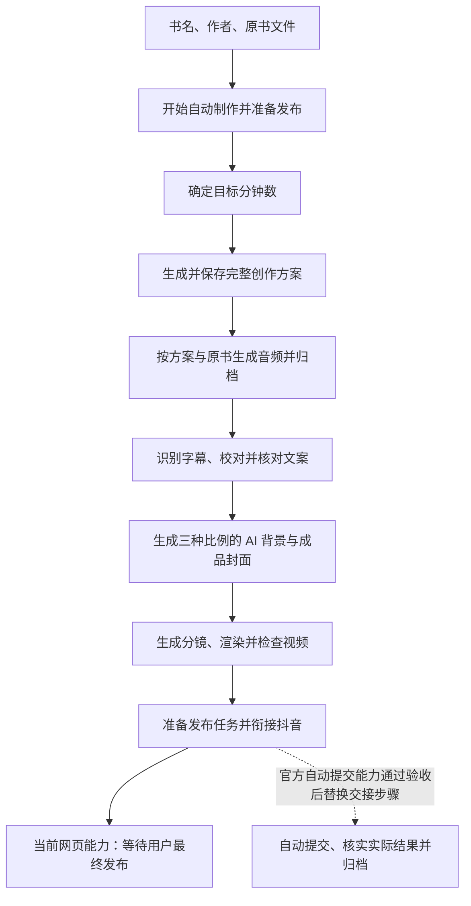

# 书籍到抖音自动制作流程修订计划

日期：2026-11-08。状态：**P1–P3代码已实施，P2/P3已完成隔离本地验证；真实书籍/账号整链待验收，P4因接入条件未满足尚未交付**。

当前顺序：已保存时长或AI推荐 → 完整创作版本 → 按版本制作音频 → 同任务字幕检查点 → 校核并必要修订发布材料 → 三尺寸背景/封面 → 同任务分镜与渲染 → 网页准备。schema23新增第三尺寸关联及独立渲染摘要，校核保留原音频指导，精确产物与恢复已接通，详见[P2/P3验收](AUTOMATION-P23-VERIFICATION.md)。正式自动提交仍缺外部条件，见[P4复核](AUTOMATION-P4-VERIFICATION.md)；[P1验收](AUTOMATION-P1-VERIFICATION.md)保留为前置创作历史证据。

规划核对基线：`dev / db5cda3`，应用 `0.53.2`，SQLite schema v21；P1追加schema22，应用版本未手工调整。本文是当前唯一的自动流程改造计划，替代本文件上一版的制作顺序；既有实现及验收事实保留在 [自动流程验收](AUTOMATION-VERIFICATION.md)、[真实流程测试记录](AUTOMATION-LIVE-TEST-20261107.md) 和 [官方能力核验](BOOK-TO-DOUYIN-P0-VERIFICATION.md)。这些历史记录不代表下文全部目标已经实现。

## 1. 结论与目标

**推荐采用用户描述的顺序：先形成一套完整创作方案，再制作音频、三尺寸 AI 背景封面和视频，最后进入抖音发布。** 在音频归档后增加一次基于实际字幕的内容校核，避免前置文案承诺了音频没有讲的内容，也避免封面生成后返工。

用户日常只填写书名、作者并选择原书文件，点击一次「自动制作并准备发布」。首次使用时配置模型、视频环境、NotebookLM 登录和抖音账号；配置有效时不要求每本书重新设置模型、再次确认生成结果或逐页点击继续。



「最后自动发布到抖音」保留为完整目标。当前可交付能力是自动上传填写后等待用户最终发布；只有正式提交和结果核验能力通过验收，按钮与完成状态才能使用「自动制作并发布」。这不是两套制作流程，区别只在最后的发布执行边界，详见第 6 节。

本次修正三个核心问题：

1. 自动流程应先运行内容创作能力，不能绕过目标时长、音频指导和封面提示词。
2. 内容页、音频任务、封面、视频和发布必须引用同一流程保存的版本及素材 ID。
3. 「生成了提示词」「生成了实际文件」「上传并填写完成」「作品实际发布」分别表示不同成果。

## 2. P1实施前的代码与差距

下表记录规划时读取的真实基线源码，用于说明改造动机；P1后的当前状态以本文顶部和P1验收记录为准。

| 环节 | 当前实现 | 本次改造 |
| --- | --- | --- |
| 启动 | [AutomationSetup.vue](../src/components/AutomationSetup.vue) 保存书籍/原书后调用 `startAutomation` | 保留一个启动入口，展示实际阶段与产物 |
| 目标分钟数 | [database/automation.rs](../src-tauri/src/database/automation.rs) 的 `create_automation` 固定 `target_duration_seconds: 600`，直接进入 `audio` | 接入已有时长保存/推荐，冻结本次目标，不再固定覆盖为 10 分钟 |
| 前置创作 | [database/ai.rs](../src-tauri/src/database/ai.rs) 和 [publishing-v7.md](../prompts/publishing-v7.md) 已能生成发布文案、音频指导及三比例封面提示词；自动流程没有调用 | 直接复用统一生成链，保存可查看的完整版本后才生成音频 |
| 音频指导 | [database/audio.rs](../src-tauri/src/database/audio.rs) 的 `start_automatic_audio` 不绑定文案版本，使用固定 `automatic-audio-v1` 指导 | 绑定前置版本中的完整指导和本次目标时长；继续上传真实原书 |
| 字幕与文案 | [automation.rs](../src-tauri/src/automation.rs) 先执行音频、字幕及分镜，再用字幕生成全部文案 | 先创作；音频完成后校核已有文案；分镜移动到封面完成之后 |
| 多尺寸封面 | [types/cover.ts](../src/types/cover.ts) 已支持三尺寸；自动执行器只处理 4:3 和 3:4 | 复用既有尺寸、图片 Provider 和 Canvas，补齐 16:9 的独立背景、配置与 PNG |
| 视频依赖 | [video_commands.rs](../src-tauri/src/video_commands.rs) 的 `execute` 连续执行转写、校对、分镜；`verify_automation_video` 依赖文案任务中的整份视频计划摘要 | 在同一视频任务中增加字幕就绪检查点，分开内容一致性检查与渲染计划检查 |
| 发布结果 | `automation.rs` 最终进入 `awaiting_publish`，页面让用户亲自点击发布 | 保留真实完成语义；最终自动提交和结果查询是单独的后续验收项 |

P1实施前的实际顺序为：

```text
audio → video_prepare（字幕、校对、分镜）→ writing（据字幕生成文案）
→ landscape_image/cover → portrait_image/cover → render → publishing
→ awaiting_publish
```

根因是自动执行器采用了另一种业务顺序，并没有串上手动内容创作的前置结果。只改按钮、导航顺序或步骤名称不能解决问题。

## 3. 每个阶段的输入、输出和通过条件

### S0：保存与启动检查

- 输入：书名、作者、一个本书原书文件。首轮继续支持当前音频路径可用的 PDF、EPUB、TXT、Markdown；书籍表单允许绑定 DOCX 不代表自动音频支持 DOCX。
- 原子保存书籍与文件关联，检查文件可读、账号有效、模型可用、视频环境可用和活动任务占用。预检失败时不开始收费生成。
- 冻结书名、作者、已有简介/资料、原书 ID 与 SHA-256、模型实际调用配置、账号和发布策略。首次配置明确本次会发送的资料、自动采用行为以及三张图片调用。
- 沿用默认的未来北京时间 01:11、禁止保存视频、不加入合集；不修改旧任务或已提交作品。
- 重复点击使用同一请求标识，仅得到一个流程。先保存再启动之间失败时保留已保存书籍，用户重试不得重新建书。

### S1：确定目标分钟数

1. 已有明确保存的目标时长时使用该值，来源可为用户设置或此前已采用的 AI 推荐；页面中的未保存值须先完成原保存。
2. 未配置时调用现有时长推荐能力，保存分钟数、推荐原因和任务结果，再进入内容生成。资料不足须说明是估计，不能假称已读取整本书。
3. 自动发布制作范围暂沿用代码现有的 **实际音频不超过 15 分钟**限制。推荐请求需带入该范围并校验结果；它是当前产品约束，不能写成所有抖音账号/路线的统一限制。已有目标超范围则在生成前提示，不悄悄改为 10 分钟，也不收费生成后才告知。
4. 将确定的秒数冻结到本流程并同步书籍字段。运行中其他页面修改目标，不得改变已经开始的音频任务。

目标时长是制作指导，不是成品保证。实际时长从音频文件读取，字幕和视频均使用实际时间轴；两者及差值须同时可见，不能把「目标 15 分钟」显示成已获得 15 分钟音频。超过现有 15 分钟上限时暂停并保留原产物；其他时长偏差如实展示，用户可主动重新制作，不新增未经样本验证的硬性偏差门槛、自动补时或收费重生成策略。

### S2：生成并保存完整创作方案

复用现有 `GenerationInput`、统一文本 Provider、结构校验及 `writing_versions`，不另建一套内容服务。按 S1 时长一次生成：

| 内容 | 下游用途 |
| --- | --- |
| 发布标题、正文、标签 | 抖音发布初稿，之后用实际音频核对 |
| 完整音频提示词 | 现有固定开场/结尾、书籍引入、五段指导及不朗读的时长参数 |
| 封面主标题、副标题 | 三尺寸封面的本地中文排版 |
| 4:3、3:4、16:9 各自的画面提示词 | 同一主题的三种独立构图 |
| 既有封面字号、配色、蒙层建议 | 原 Canvas 排版器的配置 |

结构、长度、目标时长与必填字段全部通过后，追加正式创作版本，保存本流程的版本关联。自动流程按启动授权采用该版本，不要求用户再点「采用」或「保存修改」。页面显示「制作初稿已保存」，不得提前显示音频、封面或发布完成。

**来源取舍：** 当前 `prepare_generation` 只读取书名、作者、简介与 `sourceNotes`；[note_import.rs](../src-tauri/src/note_import.rs) 也只支持有限大小的 UTF-8 TXT/Markdown。绑定 PDF/EPUB 不等于文本模型读过原书。本轮优先复用现有能力：前置方案根据已知资料形成保守初稿，禁止编造章节、引语和情节；原书在下一阶段交给 NotebookLM，实际音频后再核对发布材料。不为这次顺序修正新增电子书解析、OCR 或另一条远程读书通道。

### S3：按本次方案生成音频文件

- 现有音频任务明确绑定 S2 的文案版本、完整提示词、S1 目标时长和 S0 原书指纹。
- 继续使用现有网站窗口、来源上传、音频形式配置、提交一次、等待、精确下载、校验及归档。
- 音频页面显示的指导必须等于实际发送指导；不得另外使用自动流程固定模板替代它。
- 实际音频可解码、有正时长并成功登记为本书素材，才算完成。归档成功后的关闭网站行为继续沿用现有实现。
- 下载或归档失败只恢复原成品；外部生成结果未知先核对原笔记本，不新建笔记本、重复提交生成或盲目收费重试。

### S4：校核实际音频与发布材料

这一步是音频制作的验收，不生成第二份音频，也不要求用户逐条校稿。

1. 创建或恢复本流程唯一的视频任务，复用其现有转写与字幕校对，保存完整原始及校对后字幕；此时不生成分镜。
2. 将 S2 初稿、真实字幕、音频 ID/摘要交给统一文本 Provider，核对发布标题、正文、标签、封面主副标题及背景描述是否与实际讲述一致。
3. 一致时记录检查成功并继续引用初稿版本；不一致时只修订上述发布/封面字段，走原结构校验并追加 `based_on` 版本，再自动采用为最终发布材料。
4. **已经生成音频所用的提示词与目标时长保持原样。** 不得在校核后重写音频提示词，造成历史看起来用了另一份指导。
5. 字幕为空、输入超过现有完整处理上限、结果无效或不能确定时暂停，保留初稿和音频，不截掉后半段来假装完成；不启动图片生成。

校核只证明发布材料与音频内容相符，不等于独立核实原著事实。存储一次检查及精确输入摘要，不维护「初稿工作台」和「终稿工作台」两份可编辑状态；同一内容页通过既有历史展示两个版本。

### S5：生成三尺寸 AI 背景与成品封面

| 尺寸 | 最终 PNG | 使用范围 |
| --- | --- | --- |
| 4:3 | 1440×1080 | 当前抖音横版封面及本地素材 |
| 3:4 | 1080×1440 | 当前抖音竖版封面及本地素材 |
| 16:9 | 1920×1080 | 宽屏封面、本地预览和后续复用；不冒充抖音第三个上传字段 |

按 S4 确定的同一版本，顺序完成每个尺寸的「AI 无字背景 → 校验并自动采用 → Canvas 中文排版 → PNG 导出并绑定」。每个比例默认调用图片模型一次，三张背景分别构图；模型返回尺寸与最终 PNG 尺寸不同的处理继续沿用既有裁切逻辑。

所有尺寸共用现有 `coverPng`、字体与输出检查。通过应用根级执行端完成，用户无需停留在封面工坊。导出成功必须有实际文件、准确尺寸及本流程封面版本 ID，不能只有提示词、候选图或缩略图。

失败时保留其他尺寸；重试只执行未成功的图片请求或本地导出。图片已成功但排版失败时复用原背景，不再次调用图片模型。不静默改成纯色背景，不拉伸一张已排字封面冒充三种构图。

首轮维持单流程、串行制作。三张背景相较当前两张增加一次图片调用，换来完整尺寸覆盖；暂不并发图片与音频，避免增加取消、重试和依赖处理复杂度。

### S6：制作与检查视频

封面全部完成后，恢复 S4 的同一视频任务，基于实际校对字幕生成分镜。通过现有结构、时间轴与画面检查后自动渲染，自动模式无需再确认分镜；手动制作仍按现有操作。

沿用当前原声 MG 引擎和 1920×1080、16:9 成片。原音频是唯一时间基准，不用目标分钟数或音频提示词伪造字幕，不为凑时长裁切、补静音或变速。三尺寸封面不意味着三种视频比例，也不新增视频插画批量生成。

成片文件存在、可读画面、有音轨、音视频时长一致且关联本次音频/字幕/分镜，才能登记正式视频素材并进入发布。失败保留字幕、分镜、封面和已有视频历史，恢复只继续失败阶段。

### S7：准备发布、提交与结果归档

自动建立或复用一个发布任务，明确绑定本次最终文案版本、音频、成片、4:3/3:4 封面及账号，不能取「当前最新」历史猜测来源。

复用现有任务包、自检、网页上传填写与设置回读。定时计算使用 `Asia/Shanghai` 的最近有效未来 01:11；沿用交接前允许续算、交接后或提交结果未知不自动改期的规则。不允许保存视频不影响本地 MP4 归档。最终动作与成功判定见第 6 节。

## 4. 最小实现与数据变更

### 4.1 只调整已有编排

保留 `automation.rs` 作为唯一固定流程执行器，新增/调整阶段为：

```text
duration → writing → audio → transcript → content_check
→ landscape_image → landscape_cover
→ portrait_image → portrait_cover
→ widescreen_image → widescreen_cover
→ storyboard → render → publishing
```

阶段名是实施建议，业务顺序是验收要求。继续使用 `automation_runs` 的状态、运行代次、请求去重和子任务事务绑定；不引入通用工作流引擎、额外队列系统或第二套音视频任务。

- 为现有时长/内容生成内部入口增加自动流程绑定和冻结输入支持；不通过模拟点击内容页启动，也不把前端的 Promise 当作持久任务。
- 现有 `prepare_generation` 会在执行时读取书籍字段，接入前须改为自动任务读取本次冻结资料；时长推荐完成、项目时长保存、流程结果绑定必须原子提交。
- 修改 `start_automatic_audio` 使用已保存创作版本。当前有版本时会读取项目的最新时长，也须改为本次冻结值，保证页面、提示词和音频任务一致。
- 在原 `video_commands` 内加入字幕完成后返回的执行检查点，随后继续同一任务生成分镜。不能新增一条 ASR 流程或重复校对字幕。
- 将原「根据字幕重新生成全部文案」收敛为 S4 的校核与必要字段修订。音频初稿绑定、最终文案绑定各有明确用途。
- 原 `verify_automation_video` 读取文案任务里的完整计划摘要，不能直接搬到新顺序。内容校核绑定音频摘要、完整字幕摘要和来源版本；渲染继续绑定实际分镜计划。未改变字幕的分镜完善不应使文案失效，改动字幕则必须先重新校核。
- 在现有封面执行逻辑中补第三种尺寸，使用一个尺寸映射处理阶段、任务与封面关联，不复制三套相同实现。

### 4.2 建议的最小数据增量

P1已追加兼容v22迁移；P2/P3追加v23，包含下表第三尺寸关联及独立render_plan_sha256，禁止改写已发布迁移。

| 数据 | 推荐落点 |
| --- | --- |
| 本次流程格式、冻结简介/资料、最终确定的目标秒数及依据 | 现有 `automation_runs.input_json`；未确定时不伪装已有 10 分钟结果 |
| 时长推荐任务 | 新增可空 `duration_task_id` 外键，引用既有 `ai_tasks`；明确配置时可以没有推荐任务 |
| 前置创作任务及版本 | 复用 `writing_task_id` → `ai_tasks.version_id` |
| 音频后的内容校核及最终版本 | 新增可空 `content_check_task_id`；其任务结果引用复用的初稿版本或修订版本，检查输入记录字幕/音频摘要 |
| 16:9 图片与封面 | 新增可空 `widescreen_task_id`、`widescreen_cover_id`，与现有双尺寸关联对称 |
| 实际音频、字幕、分镜与视频 | 继续使用 `audio_jobs`、`video_jobs`、`assets`，不复制业务记录 |
| 发布状态 | 制作改造阶段沿用现有表；正式自动提交的远端标识和状态字段在接入能力核验后单独设计 |

只保存版本 ID 和任务结果，不在流程表再保存一整份可编辑文案。最终文案从成功的校核任务取得，音频仍引用前置版本。推荐说明随本次时长写入流程快照，字幕/音频摘要写入校核任务输入，不能只停留在界面内存，也不新增通用结果表。

旧流程已完成的记录按历史展示。升级时旧活动流程先暂停并保留所有子任务、原始指导及上传标记，明确可在现有音频/视频/发布详情继续处理，或结束旧流程后新建；不自动倒回前置阶段补收费调用，不把旧固定指导伪造成新生成版本。保留读取历史所需数据，不长期维护两套自动执行顺序。

同步迁移、精确备份结构检查、旧备份升级、恢复和删除关联测试。旧音频和成片不重写，用户原书不复制、不删除。

### 4.3 页面与清理范围

- [AutomationSetup.vue](../src/components/AutomationSetup.vue)：展示实际目标来源、三尺寸、发布边界和真实前置检查；保留一个启动按钮。
- [AutomationTasks.vue](../src/components/AutomationTasks.vue) 与 [services/automation.ts](../src/services/automation.ts)：阶段名、准确产物入口、失败阶段和已有产物数量；只有可靠比例才展示百分比。
- [WritingPage.vue](../src/modules/writing/WritingPage.vue)：自动完成后立即看见本次目标、文案及提示词。进入页面不再次触发时长推荐或生成；存在手工草稿时保留它，通过明确入口查看本流程采用版本，避免自动覆盖。
- 封面/视频/发布页继续展示原任务与历史。查看本次产物不需要重新选择版本；要改变已冻结依赖须停止旧流程并明确重新制作，不能悄悄改变正在运行的任务。
- 删除新流程不再调用的固定自动音频构造逻辑、旧分支和失效说明；历史任务保存的完整指导继续可读。清理以实际调用搜索为依据，不删除其他手动用途、历史素材或必要测试。
- 每个切片完成时同步 PRD、TECHNICAL-DESIGN、DATABASE、AI-RULES、USER-GUIDE 和验收文档。P1已同步，文档明确区分当前产品与后续目标。

## 5. 失败恢复、费用与运行约束

| 失败或中断位置 | 恢复要求 |
| --- | --- |
| 时长/前置文案生成 | 保留书籍与已有版本，只重试失败任务；未通过不得开始音频 |
| NotebookLM 生成结果未知 | 检查原笔记本和原生成，不直接再提交 |
| 音频已生成、下载或登记失败 | 继续下载/归档同一个产物，不重做音频 |
| 音频与文案不一致 | 保留原音频指导，只调整可核实的发布/封面字段；校核失败不生成图片 |
| 某一比例背景失败 | 保留成功比例，只重试失败比例 |
| 背景成功、封面导出失败 | 仅重做本地排版/导出，不再请求图片 |
| 分镜或渲染失败 | 继续同一视频任务，保留已完成字幕、分镜与封面 |
| 切页或窗口最小化 | 应用保持运行时继续；页面挂载不得重复发请求 |
| 应用退出/重开 | 恢复本地记录并先暂停核对；不承诺关机继续，不重放未知远端动作 |
| 上传/提交结果未知 | 优先核对原任务和平台记录，不重新上传或提交；账号变化时暂停 |

沿用单活动流程、运行代次与迟到结果校验。暂停不再启动下一阶段；取消不等于撤回外部已经接受的生成/上传。成功产物落库与绑定事务化，旧运行回调不能推进新阶段。

默认新增的调用为：未配置时长时 1 次推荐、1 次完整创作、1 次音频后内容校核、3 次图片生成。音频网站生成、字幕批量校对和分镜继续按现有任务执行，不包含在这几个文本次数中。具体费用以供应商返回为准，不预估固定金额；默认失败不自动重试，额外收费重做由明确操作触发。

文本/图片统一 Provider 的单次总超时仍为 300 秒；NotebookLM 等待、ASR、渲染和上传使用各自现有任务规则，不能把 300 秒作为整条流程截止时间。

## 6. 抖音最终自动发布的完成条件

本次用户希望「最后自动发布」，需要在计划中保留该终点，同时说明当前源码做到了哪里。

| 产品状态 | 成立条件 |
| --- | --- |
| 制作完成 | 音频、字幕、三尺寸封面与视频均有本次有效产物 |
| 发布准备完成 | 当前网页已上传并填写，材料和设置核对通过；当前状态为 `awaiting_publish` |
| 已提交 / 预约中 / 审核中 | 后续正式发布能力提供可核实的受理证据，不能直接等同公开发布 |
| 已发布 | 平台结果被可靠核实，准确作品标识/链接和实际结果已归档 |

**制作流程优先落地；真正无人值守提交单列接入里程碑，不作为修改制作顺序的前置阻塞。** 最终提交仅推荐接入经核验可用的官方发布能力，不在当前网页执行器里偷偷增加自动点击发布作为替代。

接入前须核实当前应用资格与账号授权、允许的交互模式、视频/封面提交、AI 声明、原生定时与禁止保存的表达及回读、实际结果查询。2026-11-08已重新读取9份官方公开文档，创建/上传/查询契约与[P0核验](BOOK-TO-DOUYIN-P0-VERIFICATION.md)一致；未进入控制台或调用投稿接口，尚缺条件见[P4复核](AUTOMATION-P4-VERIFICATION.md)，不能宣称已可用或永久不支持。

通过后扩展现有发布边界，由同一制作流程绑定的一条发布任务接管提交；如官方要求服务端保存应用凭据，再建设该能力必需的最小服务。提交前持久保存意图、冻结账号/内容/时间并防重复；超时或回执未知只核对原意图，不生成第二次发布。平台预约和审核是等待状态，真正成功才归档为已发布。

未通过时准确显示「等待用户最终发布」，用户处理平台声明和最终按钮，沿用实际成功记录。该状态是可交付的阶段能力，不能计为完整自动发布目标已经完成；本轮不执行真实投稿。

## 7. 实施顺序与验收

推荐按同一条链的依赖顺序实施；发布能力调查可以提前做，但不拖住 S1–S6 的顺序修正。

| 切片 | 工作内容 | 完成门槛 |
| --- | --- | --- |
| P1 前置创作贯通 | 迁移/冻结输入、目标分钟数、完整文案、真实音频版本绑定、页面结果可见 | 一次启动先保存创作版本，实际音频请求与它逐字段一致；失败不进入下阶段 |
| P2 音频校核与三尺寸封面 | 同任务字幕检查点、文案校核、三比例图片/排版/导出、单阶段恢复 | 初稿与实际音频一致，三张准确 PNG，局部失败不重复其他收费请求 |
| P3 视频及网页准备闭环 | 同任务分镜/渲染、摘要一致性、发布任务与网页填写、重启恢复 | 配置有效的代表性书籍启动后无需中途逐页操作，到 `awaiting_publish`；保留实际文件与计数证据 |
| P4 最终自动提交 | 官方能力验证、必要接入、提交去重、状态核验和归档 | 真实授权账号完成提交与结果核实，正常成功路径无最终人工点击；未通过明确列未交付 |

P1–P3 是制作流程的同一批兼容功能增强，预计按 `feat` / minor 表达；实施时按实际变化判断，不在文档阶段手工升版本。P4 在准入与真实能力确定前不承诺固定工期，不与网页辅助上传重复建设制作逻辑。

### 必须覆盖的验收场景

| 编号 | 场景 | 通过标准 |
| --- | --- | --- |
| A01 | 只填写书名、作者、原书并开始 | 自动完成前置方案，用户无需另进内容页点生成或保存 |
| A02 | 未配置分钟数 | 一次推荐并保存说明；资料不足标为估计；目标已冻结才生成内容 |
| A03 | 已保存目标为 15 分钟 | 使用 900 秒，不被固定 600 秒覆盖；实际超限仍按音频检查处理 |
| A04 | 同一创作方案 | 提示词、音频任务与界面引用同一初稿版本；失败不留下假成功或半套结果 |
| A05 | PDF/EPUB 原书 | 音频使用正确原书；前置文本不声称已经读取其全文、不编造情节 |
| A06 | 文案与音频主题偏差 | 校核在图片生成前完成，只修订发布/封面字段；原指导和初稿历史保留 |
| A07 | 目标与实际时长 | 展示两者及差值，字幕/视频采用实际时间轴；超过 15 分钟暂停，不靠裁切或变速绕过 |
| A08 | 三尺寸封面 | 3 个独立背景任务，3 个准确尺寸 PNG 与版本关联；无乱码中文、越界或拉伸 |
| A09 | 第三张背景或导出失败 | 已完成尺寸不重做；已有背景的本地导出重试不再收费 |
| A10 | 音频后继续视频 | 只有一个视频任务及同一份字幕时间轴；先封面再分镜渲染，不重复转写 |
| A11 | 修改字幕/分镜 | 字幕变化使对应内容校核失效；仅分镜变化不误判文案失效，渲染依赖仍正确 |
| A12 | 切页、重复开始、停止与迟到响应 | 不多创建流程/请求，不覆盖手工草稿，停止后不启动新阶段 |
| A13 | 各阶段重启或重试 | 已成功产物和精确 ID 保留，未知音频生成/上传/提交不自动重发 |
| A14 | 旧数据、迁移与备份 | v21 数据与旧备份升级保留旧成果和上传标记；旧活动流程明确交接，无补生成 |
| A15 | 发布材料 | 选用本次最终文案、音频、视频和双封面，16:9 本地归档；01:11 与禁止保存保持一致 |
| A16 | 当前网页边界 | 到 `awaiting_publish` 显示待用户发布；上传/预约/审核不写为已发布 |
| A17 | 完整目标 | P4 通过后，真实官方受理与最终结果有证据；至少覆盖重复触发、未知回执和账号变化，不重复投稿 |

制作体验的最终验收至少选择三本体裁不同、用户有权使用的书，记录各阶段真实开始/结束、调用次数、输入/输出 ID、音频目标/实际时长、三张封面和最终 MP4。外部登录失效等异常单独记录，不能把需要人工修复的运行算作正常零中途操作验收。真实投稿只在对应验收范围和用户授权下执行。

实施时适用检查：`npm run lint`、`npm run typecheck`、聚焦自动流程/音频/封面/视频测试、`npm run test:rust`、`npm run check:rust`、`npm run build`，以及迁移/旧备份、Windows 隔离桌面和真实服务验收。自动生成、真实网页填写、最终投稿和安装升级分别提供证据，不能用单元测试代替。

## 8. 交付边界

最初规划轮只交付本计划、开发计划入口及三份既有规划记录，未修改产品。用户随后同意推进P1，已完成前置创作、音频绑定及schema22迁移，具体文件与实际验证见[P1验收](AUTOMATION-P1-VERIFICATION.md)。

各轮检查结果记录在 [progress.md](../progress.md)，历史验收数字不计作本轮新流程验证。P2/P3当前代码及本地验证已覆盖字幕检查点、三尺寸实际导出和同视频任务闭环；下一步进行三本真实书籍/真实账号整链验收。P4仍保留独立的真实接入门槛，正式自动投稿尚未交付。
