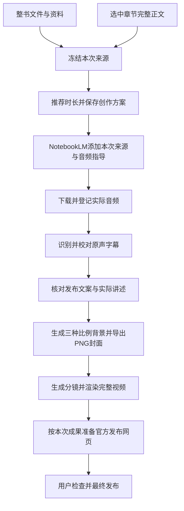

# 章节精讲完整创作设计

日期：2026-11-13。当前范围以用户本日澄清为准：一本书逐章细致解读，每章的能力与整书一致。保留原文档路径，供已有链接继续使用。实现、实际验证和未覆盖项见[本轮验收](CHAPTER-WORKFLOW-VERIFICATION.md)。

## 1. 方案与取舍

一本书下保存多个章节，用可空`chapterId`表示创作范围。为空表示整书，有值表示指定章节。整书和章节共用现有五步工作台、Provider、自动执行器、恢复、素材和发布模块。

每章都可完成文案、音频、三尺寸封面、字幕/分镜、视频及发布准备。唯一不同是资料来源和成果归属：章节任务只使用该章完整正文，成果属于该章。无需复制书籍、引入另一套制作目标或重复实现工作流。

精讲围绕本章的重要内容、概念、细节、人物动机或论证过程展开。按内容深度推荐时长，不默认做短摘要；仍不补造未提供情节、不推测其他章节或全书结论。真实模型内容质量与网站实际音频需要人工检查。

## 2. 使用流程

1. 保存书籍，在书籍资料页选择“新增章节内容…”。填写章节名称和完整正文，可导入TXT/Markdown，目标时长选填。
2. 保存后，在“本次创作范围”选择该章。侧栏、五步导航、快捷键、背景任务和成果链接继续带着本章。
3. 手动使用内容创作、封面工坊、视频制作和发布准备；也可在章节资料页选择模型、确认账号与合集后启动“自动制作并准备发布”。
4. 完成本章后切换下一章，使用相同流程。整本书和其他章节的资料、草稿、历史和作品保留。

章节名必填，1—200字；正文非空且最多10万Unicode字符，只规范BOM、换行及首尾空白。TXT/Markdown继续使用现有UTF-8、1MB导入及预览。第一版不解析PDF/EPUB目录或自动切章，不引入OCR。模型上下文限制由真实服务决定，失败保留正文，不静默截断。

章节作者继承书籍已提供的信息，不推测作者；有明确章节正文时可不填作者。整书自动制作仍要求原有书名、作者和已绑定的原书文件。

## 3. 共用完整制作链



章节自动制作与整书一致，需文本模型、图片模型、视频环境、NotebookLM和原发布账号确认。三比例为4:3（1440×1080）、3:4（1080×1440）、16:9（1920×1080）。复用现有三尺寸背景/Canvas导出、账号、合集、定时及保存权限规则。

同一个执行器和原`workflowVersion=2`继续推进，不新增`goal`分支。视频完成后继续发布准备，不提前把自动任务记为完成。手动工作台仍可独立制作任一环节，不强迫所有手工创作都调用图片模型或登录平台。

最终发布由用户在官方网页完成，准备就绪不表示已发布。沿用现有单活动自动/音频任务与运行视频限制，不在本轮加入批量章节队列。

## 4. 来源与历史版本

复用[AudioSourceInput](../src-tauri/src/database/audio.rs)：

```ts
type AudioSourceInput =
  | { kind: 'asset'; assetId: string }
  | { kind: 'text' }
  | { kind: 'chapter'; chapterId: string }
```

自动制作接收同一`source`：整书用原书文件，章节用章节ID。Rust在[chapters.rs](../src-tauri/src/database/chapters.rs)统一校验归属并生成快照。界面不自行拼接另一份章节来源。

章节快照包含书籍信息、章节ID/名称、完整正文、SHA-256及本次目标时长，进入原AI任务和文案版本。自动任务和音频任务沿用各自原有冻结输入。它们是历史只读快照，不是第二套可编辑章节状态。

必须保持：

- 文本模型接收的章节正文与NotebookLM的文本来源相同；音频指导单独写入自定义区域。
- 音频绑定本次文案版本和目标，不能拿另一章或整书的最新版本来替换。
- 字幕和分镜依据实际音频，不把章节原文冒充已朗读的字幕。
- 修改章节只影响新创作；旧任务、历史文案续作保留原正文。仅调整标题等字段保留旧音频目标；明确调整音频指导才采用新目标。

整书版本保持旧规则，不借此声称文本模型已读取绑定PDF/EPUB全文。手动保存章节方案从本章冻结来源，按项调整继承所选版本。

## 5. Prompt与网页来源

新请求共用`publishing-v8`、`publishing-revision-v7`、`audio-template-v4`、`audio-duration-v4`与`content-check-v2`。整书仍为五部分，章节允许1—5个讲解部分，不为凑段数虚构目录或重复内容。主持人和现有固定模板保留；章节开场点明书名和章节，系列名为“读懂一章”，时间预算按实际段数分配。

章节精讲要求解释有来源的细节；封面主副标题、三份图片提示词、发布标题/正文/标签均对应本章。原声字幕校对只修识别错误、不改时间码、不补台词；后置校核加入章节来源，无法确认或明显越界时暂停并保留音频、字幕。

NotebookLM仍使用应用现有独立官方窗口，每个音频任务创建独立笔记本。章节正文通过“添加来源 → 复制的文字 → 粘贴复制的文字 → 插入”进入；子弹窗可替换DOM，每步重新定位当前弹窗，不退回全页误找文字框或按钮。来源处理完成、完整指导回读成功后才提交音频生成。

NotebookLM Audio Overview是基于来源组织的讲述，不承诺逐字朗读、单一声音或精确时长。沿用Windows自动网页支持范围，macOS/Linux可使用原手动音频导入流程。参考[官方来源帮助](https://support.google.com/gemininotebook/answer/16215270?hl=en)及[Audio Overview帮助](https://support.google.com/gemininotebook/answer/16212820?hl=en)；链接不等于本轮真实网站验收。

## 6. 范围传递与失败恢复

路线保持`/projects/:id/...`，使用`?chapter=<chapterId>`。章节切换清除上一个范围的精确成果参数；从任务卡或发布队列打开结果时，同时带上章节ID与原版本/任务ID。精确ID与范围不一致时提示检查，不悄悄显示其他任务。

沿用400ms暂存和离页保存：章节资料、文案、封面owner包含章节ID，新发布表单也包含章节ID，已保存发布草稿仍绑定任务ID。切换失败停留原范围；数字时长输入按现有Input的string/number契约处理，章节错误在表单内可读并提供重新操作入口。

“输入一个章节的内容”与范围选择器共用`?chapter=new`入口，不另外用折叠状态卸载编辑器。离开章节前执行原暂存守卫，最后输入的文字也会保存；失败留在当前章节。

生成缓存键包含书籍、章节和用途。组件按路径与章节重建，切换后停止旧试听、订阅和轮询；已经发出的后台任务继续保存到原章节。全局任务和侧栏导航也传递章节，不只处理页内五步导航。

文案、音频、字幕、视频、生成背景、封面和发布关联均验证书籍与章节。书籍级静态图片/文档可以明确共享；整书音频、视频和其他章的成果不默认为共享。重定位共享素材保留原归属。

播放使用书籍ID与精确音视频素材ID读取，复用既有类型、文件存在性与单文件授权，不经过整书列表过滤。单镜调整的AI任务保存原视频任务的章节ID。手工修改音频指导时将本章当前目标保存到新版本快照，正文和名称仍继承所选版本；历史音频仅在来源快照及目标一致时允许单项取用，其他情况使用完整版本切换，避免旧指导搭配新正文。评审修复与证据见[独立评审报告](CHAPTER-WORKFLOW-REVIEW.md)。

保留原暂停/继续、有限模型重试与切换、未知提交核对、下载/归档恢复。已完成阶段不因重启或重试重复收费生成；最终手工发布边界不改变。

## 7. 数据库与备份

[0025_chapter_creation.sql](../src-tauri/migrations/0025_chapter_creation.sql)在schema24后顺序执行：

- 新建`book_chapters`，包含书籍归属、名称、正文、可空目标时长/来源及时间戳。
- `writing_versions`、`ai_tasks`、`audio_jobs`、`video_jobs`、`automation_runs`、`cover_versions`、`publish_tasks`、`assets`新增可空`chapter_id`；旧数据为NULL整书范围。
- 文案版本新增`source_snapshot_json`，继续原书籍内版本号与唯一约束，不重编号。
- `editor_drafts`不加第二张表。章节owner为`书籍ID:chapter:章节ID`，新章节使用new，新发布草稿追加`:new`。
- 旧自动输入的`selection.sourceAssetId`原位转换成`selection.source={kind:asset,assetId:原ID}`，保留其他JSON、状态、账号/合集、子任务、上传标记与成果。旧workflowVersion 0/1仍按原规则暂停交接。

已有v2—v24数据库启动升级前，先使用SQLite备份接口保存到数据库同级`chapter-upgrade-backups`目录。失败不进入迁移；迁移在原事务机制内执行，失败回滚。完整/数据库备份都包含章节、来源快照和成果，原备份只在副本上升级，继续严格结构、完整性和外键验证。

已有工作目录与源文件不搬迁、不删除。完整恢复沿用原路径重映射。单章发布不会把整本书改为已发布，有引用的章节不可直接删除或转成整书成果。回退旧程序使用升级前备份，不能让旧程序写新schema。

## 8. 验收对应

| 编号 | 行为 |
| --- | --- |
| C01 | schema24及受支持旧库升级保留整书资料、旧路径、版本、草稿与成果；原备份不改写 |
| C02 | 同书两章保存、切换、重开及完整恢复后各自完整，不覆盖sourceNotes |
| C03 | 未完成章节可暂存，保存/切换失败保稿，导入取消不改正文，错误可读 |
| C04 | 文本模型实际接收所选章节全文，另一章与整书笔记不混入，跨书来源被拒绝 |
| C05 | 推荐/手动时长只写本章，按精讲深度推荐，完整实际音频不裁切 |
| C06 | 整书五段、章节1—5段，0/6和非法输出拒绝，预算及占位符有效 |
| C07 | 音频指导、标题、标签和三尺寸封面主题对应本章，不冒充全书结论 |
| C08 | 模型来源、文案快照与NotebookLM正文一致，指导单独回读，来源未就绪不提交 |
| C09 | 修改章节后旧任务/版本继续原快照，新生成才采用新正文 |
| C10 | 字幕来自实际原声，校对不补台词，无法确认或越界时保留成果并暂停 |
| C11 | 资料、草稿、历史、音视频、封面、发布、全局任务和各入口按章隔离 |
| C12 | 章节与整书均使用完整自动流程，三尺寸封面完成后渲染，成片后继续发布准备 |
| C13 | 账号、合集、定时、保存权限及最终人工发布沿用原规则，拒绝跨章素材 |
| C14 | 暂停、重启、模型切换及部分失败保留已完成阶段，不重复生成或上传 |
| C15 | 一章发布不误标整书已发布，章节外键与原始文件保留规则有效 |
| C16 | 真实Windows章节长文本、模型、NotebookLM音频、成片与官方发布准备，以及整书回归 |

C01—C15先以本地接口、组件、页面脚本和隔离浏览器验证；模型内容质量、真实网站、安装包及其他系统的结果单独记录。C16不能用模拟页面或旧轮证据代替。实际命令与结果见[本轮验收](CHAPTER-WORKFLOW-VERIFICATION.md)。
