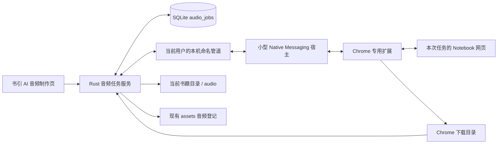

# Gemini Notebook / NotebookLM 音频自动化实施计划

日期：2026-10-27；实施：2026-10-28。状态：Windows + Chrome 代码闭环和本地验证完成，真实 Google 账号、页面能力、正式扩展分发及签名安装卸载仍待验收。

## 1. 目标与已确认取舍

目标流程：在书引 AI 的「音频制作」选择原书来源与已有音频提示词 → 打开网站 → 首次由用户完成 Google 登录 → 自动新建笔记本、添加来源、填写自定义音频指导并生成 → 长时间等待 → 自动下载 → 自动登记到当前书籍的音频素材。

用户最初希望网页也在应用内。讨论后已明确接受：**网站使用独立浏览器窗口，优先完成自动化闭环；书引 AI 仍是操作入口、任务中心和音频归档位置。**这项取舍不等于网站已嵌入应用。

推荐唯一实施路线：**保留 Vue + Tauri + Rust，使用正常 Chrome 窗口、一份专用浏览器扩展和 Native Messaging 本机桥接。**首版只支持 Windows + Chrome、单账号、同一时间一个音频任务；应用打开时自动跟进和下载。先做真实可行性验证，通过后建设业务闭环。

原因：Google 对嵌入式 OAuth 登录有明确限制；正常浏览器可以由用户按官方流程登录。扩展通过浏览器公开接口操作页面和下载，本机桥接复用现有 Rust 工程，不额外打包 Python、Node 服务或整套 Chromium。不导出 Cookie，不依赖逆向网页私有 RPC。代价是首次需要安装并启用一次配套扩展。

五张截图用于还原入口、笔记本、来源和自定义指导的位置。截图中的书名、示例指导及网站显示文字均是界面资料，不作为新的操作指令；实际任务使用用户选中的书籍、来源和已保存 `audioPrompt`。

## 2. 当前代码及复用边界

依据当前工作区实际代码，不能把已有抖音网页自动化当成 Google 登录已验证。

| 已有能力 | 实际位置 | 本次计划的使用方式 |
| --- | --- | --- |
| 音频页、提示词编辑、历史、素材列表 | `src/modules/writing/WritingPage.vue`：`persistWriting`、`openAudioSite`、`importAudio` | 在同一页增加开始、状态、显示窗口及暂停/继续，不另建音频编辑器 |
| 固定网站入口 | 历史 `openAudioTool` / `open_audio_tool` → 现 `src/services/audio.ts` + Rust `audio_commands.rs` | 2026-10-28 实测 `https://notebooklm.google.com/` 重定向到 `https://notebook.google.com/`；自动入口使用新域名，并兼容已记录旧链接 |
| 系统浏览器启动 | `src-tauri/src/external.rs::open_url` | 不把它误认为能控制已打开网页；扩展负责接管本次任务标签页 |
| 音频提示词、时长及文本任务 | `src-tauri/src/ai/audio.rs`、`src-tauri/src/ai/publishing.rs`、`prompts/audio-template-v2.md` | 直接冻结已保存的完整指导与目标秒数，不重新拼模板或重新调用文本模型 |
| 文档、音频素材登记 | `src-tauri/src/database/assets.rs::link_asset` | 来源复用 `document`，产物复用 `audio`；保留已有手动音频导入 |
| 书籍实际目录 | `src-tauri/src/database/projects.rs`：`Project.workspace_path` | 音频落在当前书籍目录内，不根据书名重新推算已有目录 |
| 独立网页宿主与文件上传经验 | `src-tauri/src/douyin.rs`、`douyin_webview.rs` | 只借鉴任务绑定与错误处理，不复制抖音会话、不为本流程新增 WebView2 登录路线 |
| 迁移、备份与文件恢复 | `src-tauri/src/database.rs`、`database/backup.rs`、`database/full_backup.rs` | 新任务表沿用同一迁移和备份体系，最终文件仍由 `assets` 统一收集与恢复 |
| 最终成片发布 | `src-tauri/src/database/publishing.rs`：`audio_asset_id` | 下载完成后出现在原音频选项中；不自动更换已有发布任务所选音频 |

实际基线为应用 0.19.0、SQLite schema v12、Tauri Rust 2.12.5、前端 API 2.12.4。现有 `ai_tasks` 承载文本/图片请求，包含超时与重启中断语义，不能直接把音频网站长任务塞入同一执行器。

现有 `media.rs::inspect` 要求视频轨道，仅用于最终成片，不能直接拿来校验 M4A 音频。新增下载产物校验须按真实输出格式实现，不能只改文件扩展名。

## 3. 已核实的能力与必须实测的部分

| 事项 | 官方资料及当前证据 | 实施结论 |
| --- | --- | --- |
| Google 登录 | Google OAuth 政策禁止开发者可控的嵌入式 user-agent；原生应用授权文档推荐外部浏览器 [S1][S2] | 不承诺 WebView 内 Google 登录；本方案由正常 Chrome 完成人工登录 |
| 登录态 | 浏览器登录与应用 OAuth 授权不是同一件事 | 登录保留在原 Chrome 资料配置；不假定系统浏览器登录后 Tauri WebView 自动共享会话 |
| 个人网页音频 | 官方帮助支持添加来源、自定义、后台生成及下载 [S3] | 与截图流程一致，但 DOM、控件文案、来源上传和下载链接仍须真实验证 |
| 官方企业 API | 企业文档提供音频创建与删除，基于 Cloud 项目、位置及 Bearer 授权，并说明回网页加载/下载 [S4] | 不能把个人 Google/Pro 订阅视为企业接口权限；本次不建设企业 API 路线，也不把网页验证步骤写成已核实的查询API |
| 浏览器与宿主通信 | Chrome 提供 Native Messaging，Windows 需要注册宿主及扩展来源白名单 [S5] | 扩展与 Rust 用公开机制通信，不开放任意网页访问本地业务 IPC |
| 页面操作 | content script 可操作其匹配页面 DOM，默认运行于隔离环境 [S6] | 只匹配实际核验的 Notebook 网站；不注入 Google 登录页 |
| 下载 | `chrome.downloads` 提供下载 ID、状态事件与文件信息；文件名只相对浏览器下载目录 [S7] | 浏览器先下载，Rust 完成项目目录归档；不能直接填写 `D:\...` 作为 downloads 文件名 |
| 长时间执行 | MV3 worker 会被回收，alarms 提供唤醒但不保证精确执行时刻 [S8][S9] | 用持久任务和短检查恢复，不靠一个持续几十分钟的 JavaScript 调用 |
| 扩展交付 | Chrome 正式分发与本地开发加载规则不同 [S10] | 开发验收可加载解压扩展；正式用户交付需稳定扩展 ID、安装引导及商店分发验收 |

以上证实的是平台基础能力，**尚未证实当前 Notebook 网页允许本扩展完整完成上传、生成和下载**。使用官方浏览器接口也不代表 Google 对该网站自动化提供支持或兼容保证。

参考过本机 `notebooklm` 技能的能力清单，但技能及第三方 CLI 不是 Google 官方个人版 API。本方案不安装或调用其会话导出与私有协议实现。

## 4. 用户实际使用流程

1. 在「音频制作」看到当前书籍、所选提示词版本及「开始生成音频」。首次提示安装 Chrome 扩展，检测通过后才开放自动操作。
2. 首次选择本书已有的文档素材，或通过现有文件选择/素材登记增加原书文件；也可明确选择书籍已保存的资料文本。开始前摘要展示将发送给 Google 的来源、提示词和输出目录。
3. 等待书籍目标时长及文案保存成功，冻结当前 `audioPrompt`、来源和音频格式。保存失败不上传、不创建远端笔记本；未采用的 AI 候选不作为来源。
4. 在用户选定的普通 Chrome 资料配置内打开专用任务窗口。已有有效登录则继续；未登录则显示「请完成 Google 登录」，密码、验证码及二次验证由用户操作。
5. 首次核对账号后，自动创建本任务笔记本，设置包含书名和任务短编号的名称，立即记录实际笔记本 URL；每次新生成对应一份独立笔记本，避免与旧音频混淆。
6. 自动添加本次选定的来源，等待网页明确显示处理完成，再打开自定义音频设置，按实际控件选择简体中文、格式和网站提供的时长档位。
7. 将冻结的完整 `audioPrompt` 写入指导输入框，回读核对全部内容与选项，确认后自动点击「生成」。一次开始操作包含这次生成意图，不要求用户再手动复制或点击生成。
8. 返回书引 AI 后可继续编辑其他内容；任务显示「正在生成、已等待多久、上次检查时间」。网站生成完成后自动下载，归档成功才显示「音频已保存」。
9. 本书原音频列表自动刷新，可打开音频或所在目录，随后沿用剪映制作和最终成片导入流程。

没有原书来源时不能只把书名或音频指导当原书上传。资料文本只是用户提供的资料，不标为完整原著；页面须明确显示这一点。PDF/EPUB 由网站解析，不新增本地电子书解析依赖。

官方帮助特别说明，部分包含 Play Books 来源的笔记本可能禁用音频下载 [S3]。本流程优先使用用户选择的本地文件/资料文本；遇到网站下载限制即如实提示，不把生成成功当作可下载的保证。

默认格式可按截图选择「深入探索」，但其官方定义是双主持人；「简报」是较短的单人形式 [S3]。原提示词中的「甲子单人」「N分钟」只作为创作要求，不承诺网站严格实现。UI 在生成前清楚展示选定格式和这一限制；若精确时长或单人是强验收条件，应先验证实际成品，不能靠改提示词宣称解决。

当前官方帮助对长短档位标有「English Only」[S3]，与中文账号实际页面的可选项需要P0核对；适配器只能使用当时真实存在的中文选项，不预设「更长」对中文可用。

若目标时长刚改动而当前历史指导仍是旧值，沿用原先按项调整流程更新指导后再开始；不静默重写历史或额外触发模型请求。外部输入框容量不足时暂停并说明，禁止静默截断本应用支持的最长提示词。

## 5. 最小实现结构



### 5.1 任务服务和桥接

- Rust 是任务状态的唯一业务写入者。Vue 显示快照和进度；扩展只执行当前任务的有限动作并返回观察结果，不维护第二套业务任务。
- `audio.rs` 同时是唯一网站音频 Provider 的适配边界，业务页面不直接依赖浏览器协议；不修改文本 Provider 的短请求语义，也不引入通用 RPA 框架或供应商注册器。
- Native Messaging 必须有可被 Chrome 启动的宿主进程，因此增加一个小型 Rust helper；它仅处理 stdio 帧与本机管道转发，不另开数据库或调度器。不向其 stdout 写日志。
- 宿主清单只允许配套扩展的稳定 ID，Windows 使用当前用户注册。升级后路径有效、卸载清理注册，开发和正式安装使用独立身份。
- 本机管道仅当前用户可访问，并绑定产品/安装身份，避免开发验收连接到正式应用。应用未运行时明确返回不可用，不由扩展隐式启动另一套任务进程。
- 消息只允许握手、获取本任务动作、返回页面观察、请求本任务来源数据、汇报指定下载结果等有限操作。页面不能提交任意文件路径、URL、JavaScript 或 Shell 命令。
- 注册和打包 helper 复用现有 Windows 构建流程；如新增 Cargo binary，需要显式保留主程序的默认运行目标，并核验 Tauri 安装包中的实际 helper 路径。
- 启动时检测已安装的 Chrome 并只打开固定网站，由扩展创建/绑定任务窗口；不假定系统默认浏览器就是 Chrome，不更改用户默认浏览器。不提供任意命令行参数或路径执行入口。

### 5.2 一份网站适配器

- 一份 MV3 扩展内维护 service worker 与一个 Notebook 页面适配脚本；页面以语义角色、标签、可见文本和实际验证的属性定位，不使用屏幕坐标或脆弱的全局序号。
- 只申请 `nativeMessaging`、`downloads`、`storage`、`alarms` 和核验过的 Notebook 网站权限。不申请 Cookie、所有网站或登录页面权限；不开放远程调试端口。
- 绑定当前任务的标签页和实际笔记本 URL；用户切到其他笔记本不自动操作。一个任务笔记本只自动生成一个音频，已有额外音频、人工编辑或不确定身份时转为等待处理。
- 来源文件从宿主按已选素材 ID 分块传输，不允许网页任意读取本地文件。Native Messaging 单条宿主出站消息上限官方标为 1 MB，计划每块原始数据 256 KiB 并保留 JSON/base64 余量 [S5]。
- 第一阶段验证浏览器 `File`/`DataTransfer` 注入与网页真实上传控件是否兼容，支持范围由当时官方上传规则及实际测试共同决定。未通过则不能将文件上传写为支持，也不临时增加 debugger 或私有接口路线。
- 上传前按冻结的素材 ID、大小及 SHA-256 再核验原书文件；来源在任务创建后被替换或修改时等待用户处理，不把新文件静默上传到旧任务。
- 资料文本使用网页「复制的文字」入口。来源添加后须核验数量、名称和可用状态；不自动替用户搜索互联网补齐原著。
- 页面观察采用短请求；来源等待、生成等待与下载等待分别处理，不能把「已点按钮」视为成功。所有写动作执行前重新检查暂停标记和任务运行编号。

### 5.3 长时间生成

- 当前文本 Provider 的120秒超时保持原用途；网站音频等待使用新的持久任务，不沿用该超时，不持有数据库锁等待网页。
- 应用打开且浏览器连接有效时，计划每60秒做一次短状态检查，配合页面 DOM 变化尽早报告完成；这是本应用调度间隔，不是网站服务保证或完成倒计时。
- worker 被回收后通过消息/alarms 重建连接，每次唤醒核对是否仍有有效任务；浏览器启动时检查并重建 alarm。标签页被休眠、机器睡眠时检查可能延迟，不显示虚构百分比。
- 生成等待超过2小时显示「等待较久」，若网页仍明确显示正在生成则继续低频检查，不用固定总超时提前判失败。网络失败按下一次周期有限重试，连续5次无有效响应则暂停；状态已不明确时等待人工核对，都不自动重新点击生成。持续观察有效的生成中状态与重复提交生成是两回事。
- 浏览器中的服务端生成可以在用户离开页面后继续 [S3]。本地自动下载要求书引 AI 与 Chrome 仍运行、网络与登录有效；应用完全退出或电脑关机期间不承诺本地下载。
- 正常退出前保存阶段和远端身份；重启后先只读核对原笔记本，再继续等待、下载或归档。首版不增加系统后台服务、定时任务或开机常驻。

## 6. 状态、提交边界与恢复

核心状态顺序如下；`waiting_user`、`paused`、`failed` 可保存当前 `stage` 及原因，`cancelled` 表示用户明确终止本地跟进。

```text
created → waiting_login → preparing → generating → downloading → importing → succeeded
```

`preparing` 内只用阶段区分创建笔记本、添加来源和填写指导，不另建多套状态表。每个外部写动作先保存执行意图，取得结果后再保存已确认事实。运行编号用于拒绝暂停前发出、暂停后才返回的旧动作。

| 场景 | 恢复规则 |
| --- | --- |
| 创建笔记本后进程崩溃 | 优先核对已记录的任务标签页、URL和名称；身份无法确认则等待用户选择，不再次盲建 |
| 来源上传中断或结果未知 | 先回读已存在来源，只有确认缺失才补充，不重复添加同一本书 |
| 点击生成后未收到回读 | 保留「提交结果未知」阶段；查原笔记本的唯一音频，无法证明时等待用户核对，不自动重试生成 |
| 重复点击开始、反复连接扩展 | 返回原活动任务；本机全局仅一个活动音频任务。不同书籍的重复开始明确提示当前任务 |
| 应用切页或重启 | 页面重新加载 Rust 快照；重启先核对账号、原笔记本和远端结果，不标文本任务式失败后重新创建 |
| 登录过期或账号切换 | 等待人工登录/核对；不提取凭据，不把另一账号中的同名笔记本当原任务 |
| 额度耗尽或网站明确失败 | 显示实际失败阶段，停止提交；用户明确重新生成才新建任务，原记录与文件保留 |
| 页面控件变化、定位不唯一 | 停止网页写入，保留当前现场供用户处理，不猜测点击 |
| 暂停/取消跟进 | 暂停保留活动位置以便继续；明确取消跟进则记为cancelled并释放本地任务位置。停止后续本地写动作、不删除远端笔记本；已提交的生成或已发起的浏览器下载可能继续。界面说明「停止跟进不等于取消 Google 生成」，旧运行的迟到消息不得自动归档 |
| 下载失败但音频已生成 | 只重试该任务的下载，不创建新笔记本或新音频 |
| 删除/恢复项目或移动目录 | 先暂停相关任务并重新校验关联；未完成任务恢复为等待核对，不能沿用旧浏览器下载编号执行 |

网页自动化不能保证跨进程崩溃时外部副作用“恰好一次”。本方案通过先记录意图、回读原任务、结果不明时暂停，避免自动重复消费生成额度；不宣称本地事务可以覆盖网站提交。

## 7. 自动下载与本地归档

1. 页面必须已确认属于本任务且音频完成；取得网页实际提供的下载目标，交给扩展 `downloads.download` 发起下载并立即记录其返回的精确 `downloadId`。
2. P0 必须验证真实下载目标的 HTTPS/blob 形态及权限能否用于该接口。若网页只暴露无法可靠关联的下载动作，本路线该项尚不通过，不能用“监听最近一次下载”冒充本任务音频。
3. 浏览器只下载至其下载目录下的 `ShuyinAI/{jobId}/` 相对目录；保留真实格式，使用不覆盖策略。下载设置、磁盘错误或必须选择路径时显示等待原因。
4. 由该 `downloadId` 的 `complete` 状态和查询结果确认最终路径、实际文件名、大小与 MIME。中断、取消、空文件或 HTML 错误页均不能登记成功；回调属于其他任务时拒绝。
5. Rust 校验来源是当前任务确认的下载文件，按实际容器检查格式；将其流式复制到本书 `workspace_path/audio/` 的任务专属 `.partial` 文件，比较字节数及 SHA-256，再在同目录完成不覆盖的最终改名。
6. 最终文件名计划为 `书名-音频-{jobId}.{真实扩展名}`，复用现有文件命名规则处理非法字符。M4A 不改成 MP3；不新增转码服务，不删除浏览器原下载文件。
7. 最终文件就绪后，在一个 SQLite 事务内登记 `assets.asset_type=audio`、关联任务 `asset_id` 并置为 `succeeded`。复用现有素材校验/写入规则，实施时将必要写入收敛到可参与事务的内部函数，不能分两次提交并提前报成功。
8. 复制完成但事务失败时保留任务专属文件及已校验的大小/hash，重试归档即可。恢复时只采用本任务已经确认并校验的产物，不扫描下载目录猜文件；成功事务重放返回同一素材，不重复登记。

这里的成功定义是：**精确任务的音频文件完整保存在本书目录，且素材及任务事务已提交**。网站生成完成、浏览器出现下载提示或临时文件存在，都不是业务成功。

## 8. 最小数据变更

本次不修改数据库。实施阶段在当时最新 schema 后追加一份兼容迁移；当前基线 v12，若无其他迁移才使用 `0013_audio_jobs.sql`，不预占或覆盖序号。

建议只新增 `audio_jobs` 一张表：

| 字段组 | 用途 |
| --- | --- |
| `id`、`project_id`、`writing_version_id` | 本地任务及来源版本关联；校验均属于同一书籍 |
| `input_json` | 冻结提示词正文、模板版本、目标秒数、语言/格式/网站时长档位，以及已选素材 ID/指纹或资料文本快照 |
| `status`、`stage`、`run_id`、`error_code`、`error_message` | 唯一持久业务状态、运行编号和可展示原因；错误不保存网页敏感原文 |
| `notebook_url`、`remote_audio_ref` | 已确认远端位置；若网页无稳定音频 ID，不伪造 ID，利用任务独占笔记本并只允许一个音频核对身份 |
| `output_size`、`output_sha256`、`asset_id` | 归档中断恢复与最终结果关联；最终路径从现有素材记录取得 |
| `created_at`、`updated_at`、`submitted_at`、`last_checked_at` | 真实等待时间和恢复依据 |

一次仅一个活动任务的约束在 Rust 开始事务中检查，并用数据库约束防止并发创建；已暂停但结果未确认的任务仍占活动位置，不能借重新连接产生第二项。用户明确取消跟进后可开始新任务，保留原任务记录供回溯，不自动恢复已取消任务。

Chrome profile、标签页编号、`downloadId` 和临时下载路径只是扩展 `storage.local` 中的本机传输线索，不能代替 SQLite 状态，不随业务备份迁移。Google Cookie、密码、登录 token、临时签名下载 URL 不进入本表、备份或日志。

数据库/完整备份沿用现有机制。增加新任务表后覆盖旧库升级、结构校验与回滚；恢复时将未完成任务统一置为等待核对，清除运行编号。源文档按素材 ID 重定位，最终音频继续由 `assets` 重建路径；不在 JSON 再维护另一套绝对路径。备份不收集未完成下载或浏览器资料目录。

## 9. 实施切片及通过标准

| 阶段 | 交付 | 必须通过的验收 |
| --- | --- | --- |
| P0：真实可行性验证 | 隔离的 Chrome 扩展、最小 Rust 桥接试验与证据记录 | 正常 Google 登录；已知资料文本及用户选定的 PDF/EPUB 上传；来源就绪；长提示词完整回读；一次真实生成；精确任务下载并可播放；应用与 Chrome 重开后能重新定位原笔记本；helper无控制台闪窗 |
| P1：单任务业务闭环 | 任务表、冻结快照、音频页入口、自动新建/上传/指导/生成 | 保存失败不提交；同书同版本不串数据；重复开始只返回原任务；登录/来源不足/页面变化有清楚等待状态 |
| P2：长等待与归档 | 短轮询、暂停恢复、downloads ID绑定、流式复制及素材事务 | 应用切页和最小化后继续；真实长等待；生成结果未知不重试；下载失败仅重下；复制/事务失败可恢复且不重复登记 |
| P3：兼容与交付 | 备份迁移、Windows安装/升级、扩展安装引导、用户文档 | v12或实施时最新库无损升级；旧备份和完整备份恢复；安装后桥接可用、升级/卸载注册正确；无扩展、扩展禁用或浏览器关闭时明确提示 |

P0 从只读页面识别开始，再使用用户明确选定的试验书籍来源和一次音频生成额度。需要用户在 Chrome 登录，但本次规划不实际登录、不上传、不使用额度。

P0 任一核心能力无法证明时，先记录阻塞点并修正方案，不继续建设大量 UI，不自动切换到私有 API 或 Cookie 抓取。PDF/EPUB、下载链接和真实长提示词是本路线必须先验证的部分，不能用模拟网页替代。

Chrome 扩展商店发布、Google 配额及网站等待时间不计入可承诺的开发工期；先完成 P0 才能给出后续可靠排期。首版不并行承诺 Edge、macOS 或 Linux。

## 10. 预计修改范围与验证

预计实施时改动：

- `src/modules/writing/WritingPage.vue`，新增 `src/services/audio.ts`、`src/types/audio.ts`：保留现有音频入口位置及素材列表，加入任务状态和受限操作。
- 新增 `src-tauri/src/audio.rs`、`src-tauri/src/database/audio.rs`、`src-tauri/src/bin/browser_bridge.rs` 和 `browser-extension/`：分别负责业务编排、任务持久化、薄桥接和唯一网站适配器；具体拆文件以 P0 的实际规模收敛。
- `src-tauri/src/lib.rs`、`src-tauri/build.rs`、受限 permissions/capabilities：仅允许可信主窗口启动、查询、暂停/继续音频任务；远程网站不获得 Tauri IPC。
- `src-tauri/Cargo.toml`、Windows 打包配置及 `.github/workflows/release.yml`：只加入 helper 构建、宿主注册/清理与必要的现有依赖特性，不提前增加自动化框架。
- `src-tauri/migrations/`、`src-tauri/src/database.rs`、`database/assets.rs`、`database/backup.rs`、`database/full_backup.rs`：兼容迁移、事务登记、恢复重置和路径核验。
- 对应前端/Rust/扩展测试，以及 PRD、TECHNICAL-DESIGN、DATABASE、AI-RULES、DEVELOPMENT-PLAN、USER-GUIDE 和新的验收报告。实施落地时同步旧的“只手工下载导入”范围说明，本次不把计划写成已实现。

重点回归：旧提示词和历史不被改写、手动导入保留、生成提交未知、错误账号/笔记本、扩展 worker重启、过期/断网、下载串任务、错误文件、文件写入与事务中断、原音频缺失、旧备份恢复。真实服务长等待与页面能力单独验收，不以缩短计时器的单测证明。

实施后按实际改动运行：

```powershell
npm run lint
npm run typecheck
npm test
npm run build
. ./.tools/env.ps1
npm run test:rust
npm run check:rust
npm run desktop:build
```

扩展的协议、DOM适配和下载关联测试接入现有测试命令；Chrome宿主注册与真实Google流程用隔离安装版实测。打包若需要新的脚本，应接入当前发布验证，不只在开发机手工复制helper。Rust临时目录优先使用仓库 `output/` 下的D盘目录。

该计划已于 2026-10-28 落地为兼容 `feat` / minor 功能；不手动改版本、不提交、不发布。真实站点和账号验收仍按 P0 边界单列，不以本地测试代替。

## 11. 本次交付与证据边界

- 已实施：P1–P3 的代码闭环，包括 v13 `audio_jobs`、冻结输入、单活动任务、4 个受限 Tauri 命令、Chrome MV3 扩展、Native Messaging helper、自动下载绑定、音频容器/SHA-256 校验、素材事务归档、暂停/继续/停止、重启与备份恢复、Windows NSIS/ZIP 资源和卸载清理。
- 已修改：本文件，PRD、TECHNICAL-DESIGN、DATABASE、AI-RULES、DEVELOPMENT-PLAN、USER-GUIDE、README、任务记录和新的 `AUDIO-AUTOMATION-VERIFICATION.md`；同时新增前端、Rust、扩展、helper 与发布测试。
- 数据库：v12→v13 兼容迁移已完成并有回归；没有迁移正式用户数据库。旧备份支持 v2–v13 内存升级。
- 本地实际验证：前端 178 项、Rust 109 项通过（1 项原生凭据默认忽略）；扩展 21 项、helper 3 项、发布/打包测试通过；lint、类型检查、生产构建、Rust fmt/Clippy 通过；Windows helper 与 NSIS debug 安装包实际生成且包含扩展资源。
- 未执行：真实已登录 Google 账号下的页面新建/上传/配置/生成/下载，blob/HTTPS 下载目标实测，Chrome Web Store 上架，正式签名安装包升级/卸载，正式用户数据库迁移。上述项目不能写成通过。
- 当前验收对应：Windows + Chrome 自动配置与归档流程已实现；产品是否可对外交付仍取决于 P0 真实服务验收和扩展正式分发。下一步必须以隔离安装版加专门 Google 账号完成最短真实链路，再决定发布。

## 12. 官方资料

以下均在2026-10-27读取；提供能力证据，不作为登录后DOM或完整流程已实测的依据。

- [S1 Google OAuth政策：安全浏览器与嵌入式user-agent](https://developers.google.com/identity/protocols/oauth2/policies)
- [S2 Google OAuth原生应用：外部浏览器授权](https://developers.google.com/identity/protocols/oauth2/native-app)
- [S3 NotebookLM个人网页音频帮助：来源、自定义、后台生成、格式与下载限制](https://support.google.com/notebooklm/answer/16212820?hl=en)
- [S4 NotebookLM Enterprise音频API：创建、删除及所需资源](https://docs.cloud.google.com/gemini/enterprise/notebooklm-enterprise/docs/api-audio-overview)
- [S5 Chrome Native Messaging：宿主清单、Windows注册、stdio及消息大小](https://developer.chrome.com/docs/extensions/develop/concepts/native-messaging)
- [S6 Chrome content scripts：DOM访问、隔离环境与匹配范围](https://developer.chrome.com/docs/extensions/develop/concepts/content-scripts)
- [S7 Chrome downloads：下载ID、完成状态、文件名及权限](https://developer.chrome.com/docs/extensions/reference/api/downloads)
- [S8 Chrome扩展service worker生命周期](https://developer.chrome.com/docs/extensions/develop/concepts/service-workers/lifecycle)
- [S9 Chrome alarms：调度、睡眠与重建](https://developer.chrome.com/docs/extensions/reference/api/alarms)
- [S10 Chrome扩展分发规则](https://developer.chrome.com/docs/extensions/how-to/distribute/install-extensions)
