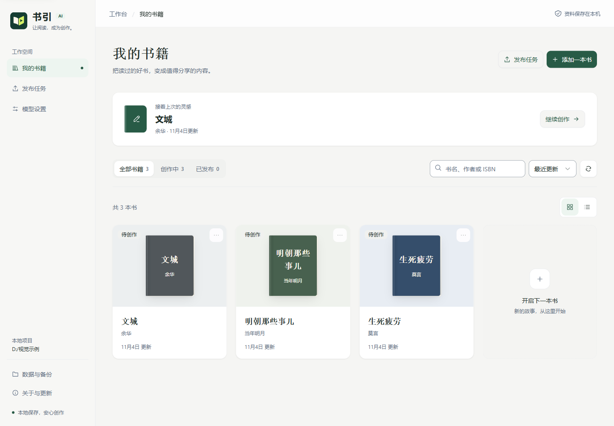
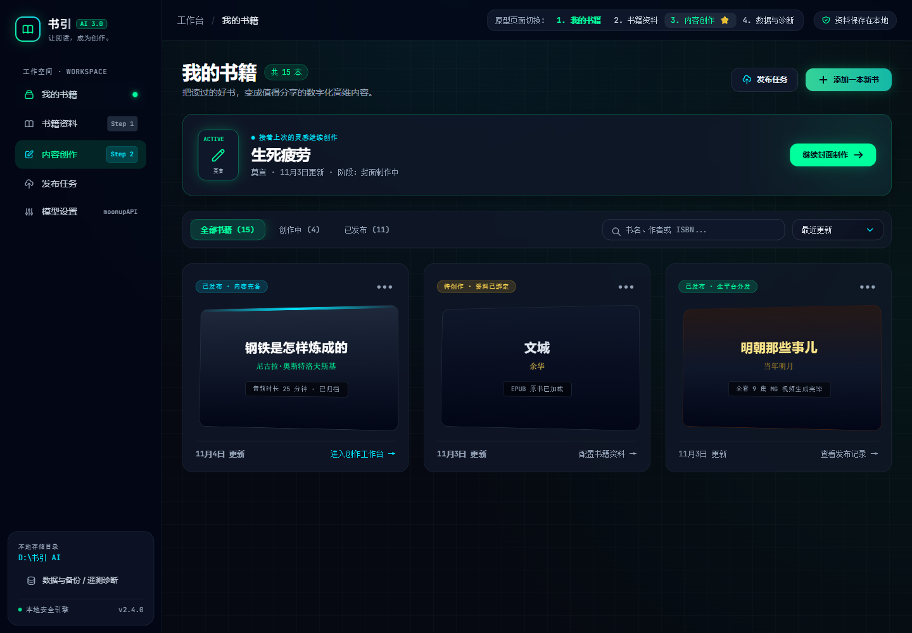
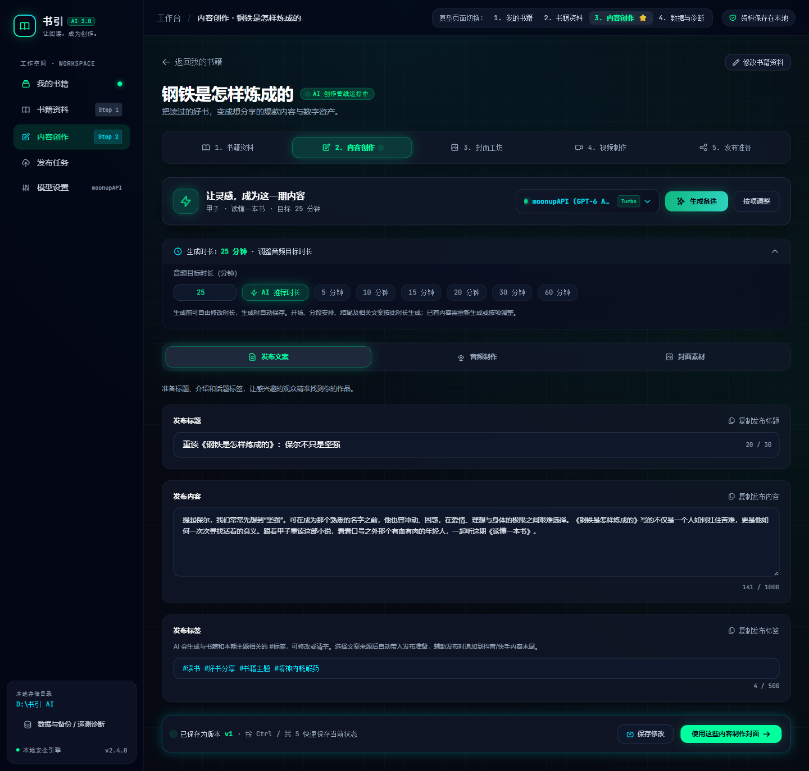

# 书引 AI 科技风格局部升级方案

日期：2026-11-05
状态：首批页面源码已实施；实际验证与边界见 [本轮验收](TECH-STYLE-UPGRADE-VERIFICATION.md)。
参考文件：用户提供的 `D:/谷歌浏览器下载/工作账号下载/ai.html`。

## 1. 最终方案

按参考文件的真实 HTML、CSS 与浏览器计算样式实现应用框架、书架、书籍资料和内容创作三个页签。采用深蓝黑、青绿、冰青、玻璃面板、霓虹边界与横向立体书封；布局、字号、圆角、留白、控件高度和交互光效以原稿为准。

本方案取代最初草案中放大正文、保留竖向书封、压低光效与窄侧栏的建议。共享主题只有一套，基础控件沿用现有 Vue 3、Tailwind CSS 4 与 Reka UI，不新增主题开关、UI 库、动画库或业务状态。

参考中的样例书籍、固定计数、版本号、模型用量、Turbo 标记、模拟成功和波形都属于展示内容。正式页面继续读取当前数据与真实媒体；页面快捷入口连接已有路由，不保留原型脚本或演示成功逻辑。

## 2. 范围

| 区域 | 本轮内容 |
| --- | --- |
| 应用框架 | 256px 侧栏、64px 顶栏、36px 背景网格、青绿品牌边界、导航选中态、存储信息与版本入口 |
| 我的书籍 | 标题计数、续作卡、筛选搜索、三列横向书封卡片、悬停 3D 效果、网格与列表及书籍菜单 |
| 书籍资料 | 返回与当前目标、五项导航、桌面 2:1 表单/指南布局、来源文件、紧凑笔记区和表单操作栏 |
| 发布文案 | 生成区、模型选择、时长折叠区、页签、标题/正文/标签、复制反馈、底部保存与历史入口 |
| 音频制作 | 提示词区、来源/格式分组、真实任务与文件信息、蓝黑播放器、试听/定位/倍速/音量 |
| 封面素材 | 推荐排版、四色卡、主副标题并排、三种比例提示词、复制及已有封面流程 |
| 其他路由 | 共享深色控件、浮层、确认、提示、通知和原有硬编码浅色区域的适配；业务布局保持原有结构 |

参考的桌面栅格在宽度至少 1024px 时为三列书架，768–1023px 为两列，更窄为一列。应用在窄窗口保留可用的图标导航；真实书籍数量、长字段和实际任务会影响内容长度，页面不伪造原稿的演示数据。

## 3. 视觉规范

| 项目 | 当前采用值 |
| --- | --- |
| 应用背景 | `#060911` |
| 侧栏、顶栏 | `rgba(2, 6, 23, 0.7)` |
| 普通玻璃面板 | `rgba(16, 23, 42, 0.72)`，16px 模糊 |
| 输入底 | `#0F172A` |
| 常规边界、输入边界 | `#1E293B`、`#334155` |
| 主操作、辅助强调 | `#00FF9D`、`#00E5FF` |
| 常规正文、辅助文字 | `#F1F5F9`、`#94A3B8`；编辑正文 `#E2E8F0` |
| 主按钮文字 | `#020617` |
| 页面标题 | 30px / 36px，900 字重 |
| 页面内边距 | 桌面 32px，小窗口 24px，再窄为横向 16px |
| 卡片 | 16px 圆角，20px 内边距；资料主表单为 24px 内边距 |
| 常规控件 | 12px 圆角；生成区模型选择 256×44px；时长输入 112×30px |
| 标题、正文、标签 | 14px / 20px，12px / 19.5px，12px / 16px |
| 字体 | 本地打包的 Inter 与 JetBrains Mono，缺失字形由系统字族显示 |
| 光晕 | `0 0 20px -3px rgba(0, 255, 157, 0.35)`，冰青采用对应色值 |

Inter 与 JetBrains Mono 的 Latin 字体文件及 OFL 许可位于 [字体目录](../src/assets/fonts)。不在运行时请求 Google Fonts 或 Tailwind CDN。

横向书封采用原稿的蓝灰、深色与暖金表现；移除旧竖向书脊及十二套浅底示意。配色不写库，不改变正式封面配置或导出文件。当前页、成功、提醒和失败继续使用真实语义，不把人工书籍状态扩充为未经核实的完成度。

## 4. 实现约定

- 共享主题与布局由 [src/style.css](../src/style.css) 维护，根文档声明深色原生控件语义；浮层挂载到 body 后仍取得主题。
- [App.vue](../src/App.vue) 复用原目录、偏好、更新和路由逻辑；目录入口收敛到路径旁的图标，版本入口打开关于与更新，创作提示可展开与收起。
- [BookCard.vue](../src/components/BookCard.vue) 复用原菜单与操作。一组 CSS 变量表达网格/列表布局，避免作用域全局选择器误命中书架容器。
- [ProjectPage.vue](../src/modules/projects/ProjectPage.vue) 复用现有字段、来源关联、笔记导入、未保存保护和保存命令，不增加第二份资料表单。
- [WritingPage.vue](../src/modules/writing/WritingPage.vue) 继续使用同一份草稿、版本、候选和历史状态。四个紧凑字段使用单行外观的 Textarea，保留既有换行、复制与保存能力，不让原生 Input 删除换行。
- 历史入口位于底部保存状态中，沿用原 `historyOpen` 和一套 Collapsible；历史先预览、对照，明确取用才改当前稿。
- [AudioPlayer.vue](../src/components/AudioPlayer.vue) 与 [AudioWaveform.vue](../src/components/AudioWaveform.vue) 只改变外观。波形仍由本地音频解码，播放仍使用同一真实媒体元素；原 OLED 配色入口继续可用。
- [CoverDesignPreview.vue](../src/components/CoverDesignPreview.vue) 共用排版与色卡，在不同上下文通过提示插槽展示说明，不复制色卡渲染器。
- 已保存内容、原声、字幕时间码、视频进度、封面导出与最终人工发布边界继续沿用原流程。
- 用户减少动画或透明效果时，关闭非必要变换/模糊并使用深色实面。

## 5. 验收标准

1. 首批页面采用参考稿的布局、色彩、字体、尺寸、圆角、材质与光效；使用同尺寸浏览器计算样式和截图对照。
2. 所有现有路由具备可读深色基础，常规、悬停、焦点、禁用、等待、提醒和失败可辨认。
3. 长书名、长模型名、来源路径、空状态、菜单、弹窗与底部操作栏不被裁切，窄窗口可操作。
4. 网格/列表、搜索、排序、目录、取消删除、键盘菜单、焦点返回、快捷键和未保存保护保持有效。
5. 换行、编辑、复制、保存、自动暂存、候选和历史继续正确；停止与失败保留原稿。
6. 音频真实播放、倍速、定位、暂停与配色切换正常；不模拟波形或进度。
7. 适用的 lint、类型检查、已有测试、构建和实际运行验证通过；安装、系统缩放与外部服务证据单独列明。

验收命令、结果、截图和剩余边界集中记录于 [科技风格升级验收](TECH-STYLE-UPGRADE-VERIFICATION.md)。数据库、依赖和权限不变，发布影响为 `style` / `refactor` / `fix`，按项目规则默认 patch；本轮不手动改版本、提交或发布。

## 6. 对照材料

以下为改造前页面与用户原稿，属于视觉基线：

当前实现的截图见本轮验收报告；示例书籍与任务均明确用于隔离验证，不代表用户数据库或真实平台发布记录。
