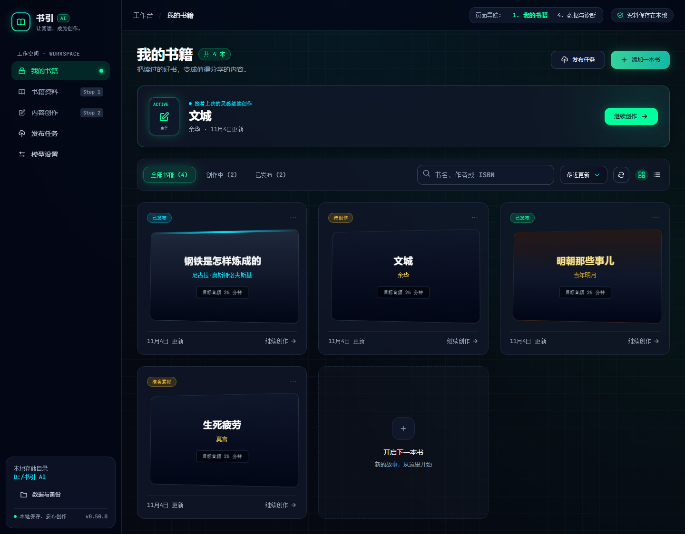
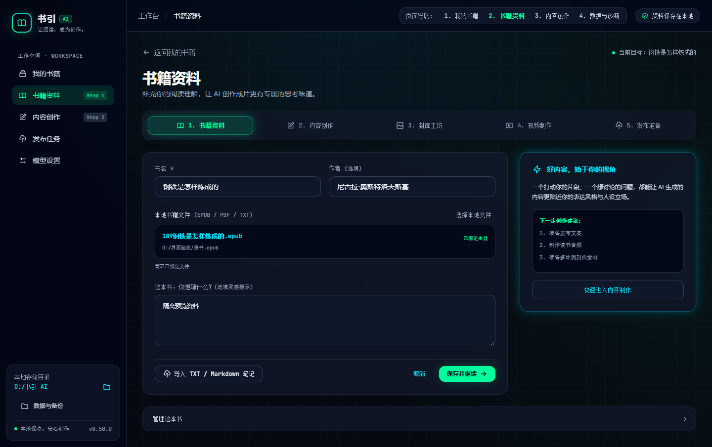
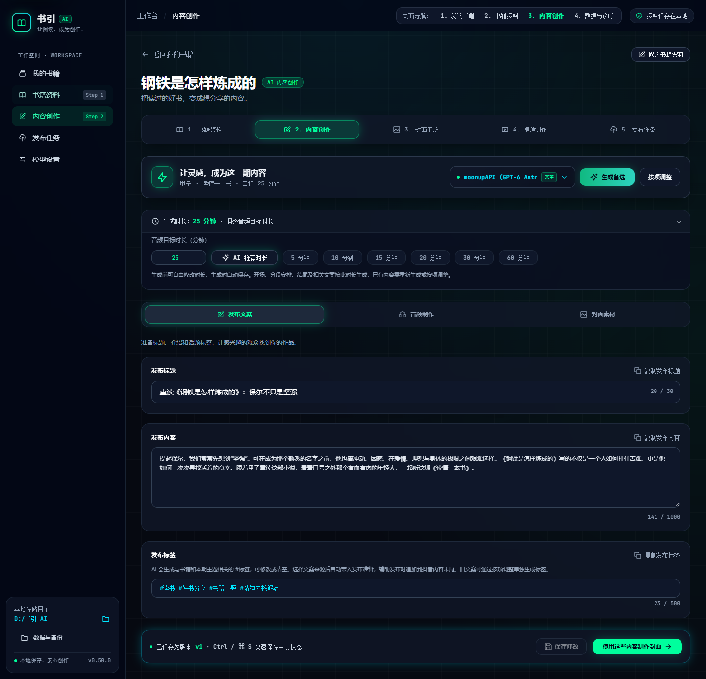
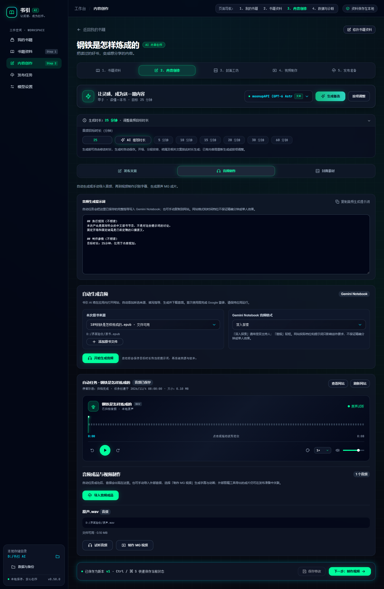
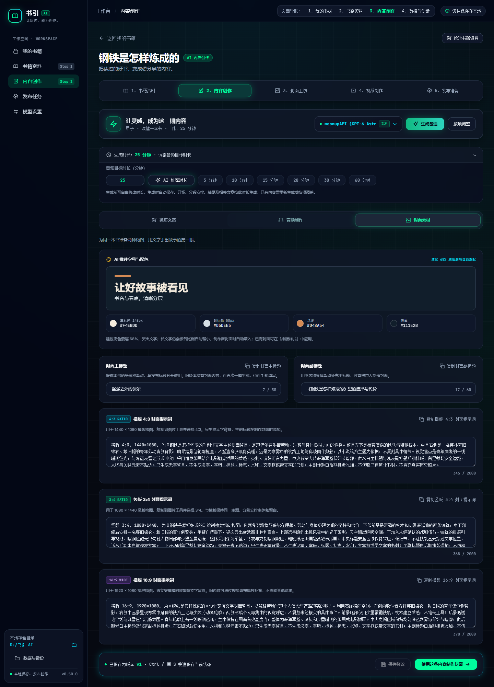

# 科技风格页面升级验收

日期：2026-11-05
结果：首批页面源码升级与本地验证完成。以用户提供的 `ai.html` 为视觉依据；完整规范见 [最终方案](TECH-STYLE-UPGRADE-PLAN.md)。

## 1. 实现与影响

完成应用框架、书架、书籍资料与内容创作的发布文案、音频制作、封面素材三项页签。采用参考稿的256px侧栏、深蓝黑网格、玻璃卡片、青绿/冰青光效、横向立体书封、紧凑控件及原字体。字体文件随构建本地打包，运行不依赖字体或Tailwind CDN。

现有确认、菜单、保存、候选、草稿、历史、原声音频和发布流程继续沿用。一份文案编辑状态、一套历史Collapsible和同一媒体组件贯穿现有页面；未增加主题存储、状态机或业务接口。

四个紧凑字段继续使用Textarea，外观对齐单行输入但保留已有换行、编辑和复制能力。历史触发器移入保存状态，仍先预览、对照和主动取用。书架列表通过继承CSS变量管理布局，移除误将作用域规则作用于整个书架的选择器；菜单按钮保持可点击，未用提高z-index遮掩裁切。

其他路由仅处理共享深色基础、旧浅色背景和提醒颜色，未重排封面画布、视频分镜、发布自检、模型库或备份工作流。正式封面内容、视频画面、原声、字幕时间码和源文件不随应用配色改变。

发布影响为style/refactor/fix（patch）；版本保持0.50.0，本轮未提交、发布或更新正式安装版。

## 2. 修改文件

| 范围 | 文件 |
| --- | --- |
| 根布局与主题 | `index.html`、`src/App.vue`、`src/style.css` |
| 书架和资料 | `src/components/BookCard.vue`、`src/components/ProjectNavigation.vue`、`src/modules/projects/ProjectsPage.vue`、`src/modules/projects/ProjectPage.vue` |
| 创作、媒体、排版 | `src/modules/writing/WritingPage.vue`、`src/components/AudioPlayer.vue`、`src/components/AudioWaveform.vue`、`src/components/CopyButton.vue`、`src/components/CoverDesignPreview.vue` |
| 共享控件与反馈 | `src/components/AppIcon.vue`、`src/components/AppNotifications.vue`、`src/components/ui/{button,badge,input,textarea,select,slider,tabs,alert-dialog}/`中的对应实现 |
| 其余路由基础适配 | `src/modules/settings/ModelsPage.vue`、`src/modules/covers/CoversPage.vue`、`src/modules/publishing/{PublishingPage,PublishQueuePage}.vue` |
| 已有回归 | `tests/ai.test.ts`、`tests/covers.test.ts`、`tests/browser/book-menu.mjs`；仅适配历史入口和显示格式/主题，原行为断言继续保留 |
| 字体 | `src/assets/fonts/inter-latin.woff2`、`jetbrains-mono-latin.woff2`及两份OFL许可 |
| 文档与图片 | 本报告、最终方案、PRD、技术设计、数据库、AI规则、开发计划、用户指南、品牌说明及`docs/assets/tech-style/` |

没有修改Rust业务源码、数据库迁移、package.json、锁文件、发布配置或正式capability。

## 3. 数据库与文件

无表、列、索引或SQL迁移，schema仍为17。界面与播放器配色不写库；目录与创作提示沿用原设置。原AI、草稿、版本、素材和发布数据契约保持有效。

Windows运行验证使用独立identifier `com.shuyin.tech-style-20261104`。测试工作区位于D盘的 `output/playwright/tech-style/native-workspace-*`；Tauri默认的隔离SQLite/WebView资料位于C盘 `AppData/Local/com.shuyin.tech-style-20261104`，未替换正式数据库。验证音频和Markdown是本轮测试副本，源文件摘要前后相同。

最终独立SQLite只读核对：`user_version=17`、`integrity_check=ok`、外键错误0，本次书籍版本为v2/v1，新增模型调用0。资料保存、正常退出后重启恢复及真实媒体播放已实际执行。

原 `ai.html` 仅被读取供本地预览，文件大小124024字节、最后修改时间2026-11-04 23:01:55保持原值。

## 4. 实际命令与结果

| 命令/工具 | 结果 |
| --- | --- |
| `npm run lint` | 通过，0 ESLint警告 |
| `npm run build` | Vue TypeScript检查与Vite生产构建通过，Inter和JetBrains Mono两份woff2已进入dist |
| 下列Vitest命令 | 12个文件247项通过，覆盖资料/菜单、快捷键、文案/候选/换行、草稿/历史、确认/复制、媒体、封面导出、发布与备份 |
| `npm run preview -- --port 14329 --strictPort` | 最终生产预览启动成功 |
| Playwright `layout.cjs` | 14个页面×5档窗口共70组通过，正文对比度、深色表面及页面/工作区无横向溢出；计算包含实际透明层和渐变色 |
| Playwright `interactions-final.cjs` | 7组交互通过，页面异常0：快捷保存、换行复制、历史开关、等待/停止保稿、生成备选保稿、真实WAV/倍速/配色/离页暂停、资料保存、五路由快捷键、取消删除及减少动画/透明效果 |
| Playwright现有书籍菜单回归 | 5档窗口与按钮/右键/菜单键/Shift+F10/Enter/Space/方向键、边缘避让、焦点返回、目录、取消删除、列表、长标题及禁用项通过，页面异常0 |
| 参考稿与生产构建计算样式对照 | 顶栏、五项导航、生成区、时长输入、标题、正文、标签和模型选择共8处×14个属性完全一致，1440px视口；包括位置、尺寸、字体、行高、内边距、圆角、背景/前景、边界与模糊 |
| `npm run desktop:build -- --no-bundle --config output/playwright/tech-style/tauri.native.conf.json` | Windows Release独立应用构建通过，未生成安装包或更新签名产物 |
| `node output/playwright/tech-style/native.cjs` | 真实Windows WebView2/Tauri IPC/SQLite，7个页面×3档实际窗口共21组通过；真实WAV播放、保存v2、退出/重启恢复、本地字体加载和源摘要保持通过，页面异常0，最终运行新增模型调用0 |
| 独立SQLite只读审计 | schema17、完整性ok、外键错误0、保存版本v2/v1、当前书籍模型调用0 |
| `git diff --check`、新增文档空白检查与`python output/playwright/tech-style/check-documents.py` | 通过，20处本地引用有效，PNG签名、文本编码与最终验证报告检查通过 |

完整的已有测试命令：

```powershell
npx vitest run tests/projects.test.ts tests/ui-refinement.test.ts tests/ai.test.ts tests/drafts.test.ts tests/confirmation.test.ts tests/notifications.test.ts tests/audio-player.test.ts tests/audio-waveform.test.ts tests/covers.test.ts tests/coverRenderer.test.ts tests/publishing.test.ts tests/maintenance.test.ts --maxWorkers=2
```

Playwright使用当前已安装的CLI，实际调用形式如下；JSON中的`isError`及业务断言均已检查，不以进程退出0替代通过：

```powershell
$pw = 'D:/DevCache/npm-cache/_npx/31e32ef8478fbf80/node_modules/@playwright/cli/playwright-cli.js'
node $pw -s=tech-style-production run-code --filename output/playwright/tech-style/layout.cjs --json
node $pw -s=tech-style-flow-final run-code --filename output/playwright/tech-style/interactions-final.cjs --json
node $pw -s=tech-style-menu-final run-code --filename output/playwright/tech-style/menu.cjs --json
node $pw -s=tech-style-golden-production run-code --filename output/playwright/tech-style/production-compare.cjs --json
. ./.tools/env.ps1
npm run desktop:build -- --no-bundle --config output/playwright/tech-style/tauri.native.conf.json
node output/playwright/tech-style/native.cjs
```

浏览器五档为1440×900、1366×768、1120×900、800×1000、360×900。Windows实际子窗口为1440×900、1120×900、800×700；只调整本任务子进程的窗口，没有改变用户系统缩放，也没有为验证增加应用capability。

原有大于500kB的JavaScript分块提示和npm用户配置提示仍可见，未通过放宽构建规则消除；本轮不将无关分块优化加入样式任务。

## 5. 证据与当前预览

JSON报告、计算样式和Windows图片位于忽略的 `output/playwright/tech-style/`：

- `production-layout-result.json`：最终生产构建70组布局与对比度结果。
- `interactions-final-result.json`、`menu-result.json`：交互与书籍菜单结果。
- `style-reference.json`、`style-production.json`、`style-match-result.json`：真实原稿与生产构建的测量对照。
- `native-result.json`、`native-data-audit.json`、`native-*.png`：真实Windows/IPC/SQLite、字体与重启证据。

以下截图来自最终生产构建；书籍与任务是隔离示例数据，原稿里的固定数量、身份、版本、推理速度和成功状态没有被当作业务数据导入。

### 我的书籍



### 书籍资料



### 发布文案



### 音频制作



### 封面素材



## 6. 验收对应与边界

| 标准 | 本轮结果 |
| --- | --- |
| 按原稿尺寸与视觉语言实现首批页面 | 已实施，8处关键元素112个测量属性与真实原稿同值，并留存最终图片 |
| 共享主题与浮层可读 | 最终生产构建14个页面70组通过，实际展开菜单/确认和媒体倍速菜单通过 |
| 编辑、换行、草稿、历史与失败保护 | 已有测试与浏览器流程通过，实际Windows保存及重启恢复通过 |
| 真实媒体与源文件保持 | 浏览器和Windows WAV播放通过，源摘要不变；没有模拟波形或时间码 |
| 原导航、菜单、键盘及取消语义 | 已有回归与实际菜单交互通过 |
| 适用的工程检查 | lint、类型/前端构建、247项已有测试、Windows无安装包构建通过 |
| 全平台/安装/真实业务覆盖 | 继续单独验收，见以下范围 |

本轮未重跑Rust单元测试/Clippy（未改Rust业务）、Windows正式安装升级、实际100%/125%/150%系统缩放、原生文件选择和跨窗口拖入手势、macOS/Linux或真实外部模型/抖音发布。新源码没有被声明为已发布或已更新用户安装版。

不同真实内容、模型名称、书籍数、任务状态和媒体波形会改变文字与数据；本轮对齐样式，不以截图伪造平台结果或覆盖现有资料。

下一步建议：在包含本轮源码的正式桌面构建中检查用户的实际书籍与系统缩放，再按既有发布流程升级安装版。封面工坊、视频制作、发布准备及设置页的进一步布局精修不属于本轮首批范围。
