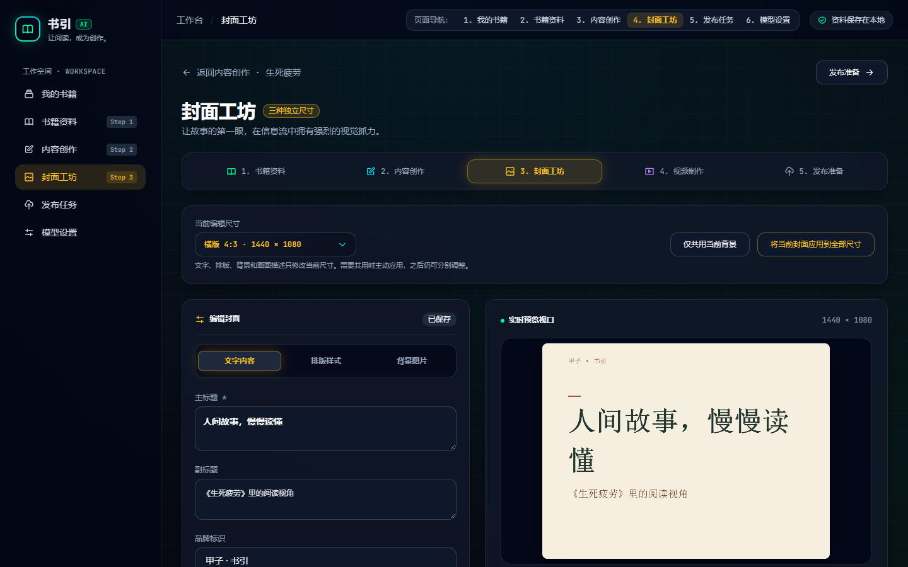
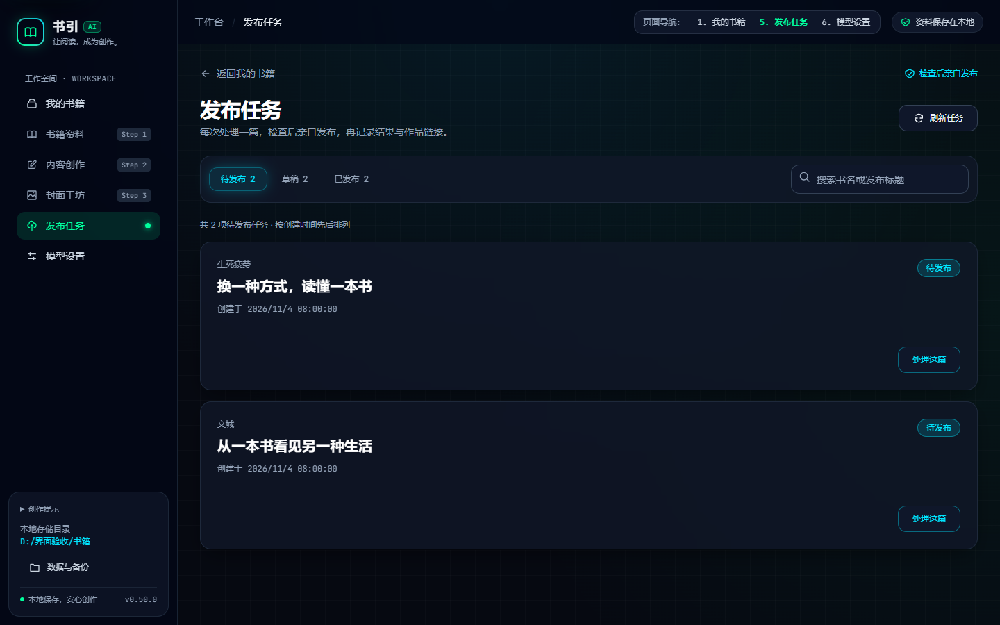
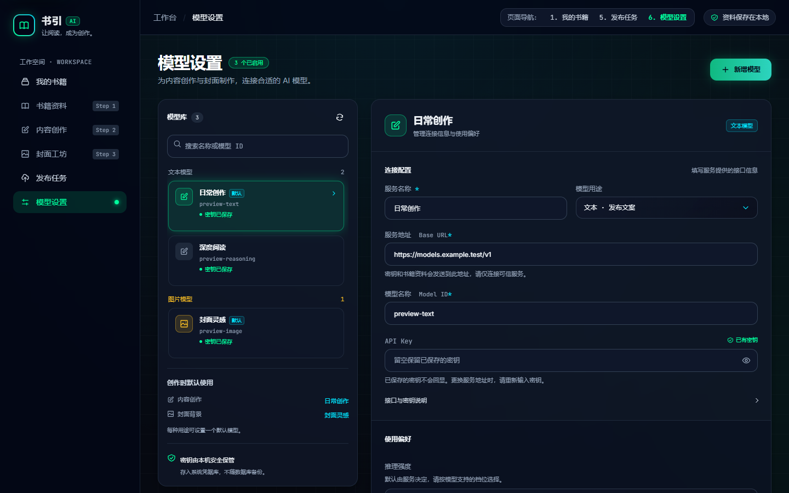
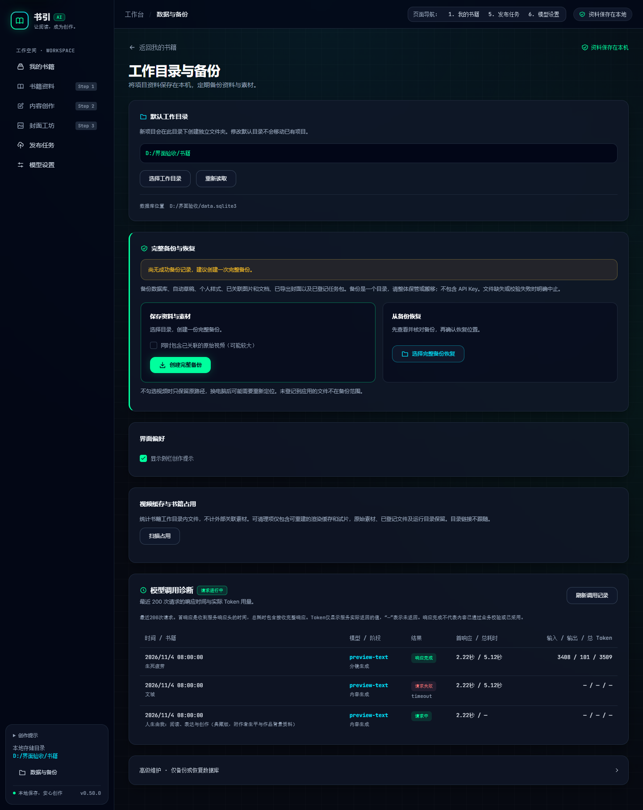

# 第二版科技页面实现与验收

日期：2026-11-05。参考：用户提供的 `D:/谷歌浏览器下载/工作账号下载/ai-2.html`。

## 实现与取舍

延续首批页面已经使用的唯一深色主题，不新建原型应用或平行业务流程。参考稿中的固定书籍、模型、密钥示例、版本、计数、状态、模拟生成与遥测不进入实际业务数据。

| 页面 | 本轮实现 |
| --- | --- |
| 封面工坊 | 返回/发布入口、琥珀强调、五步导航、横向尺寸控制、5:7 编辑/画布双栏、三编辑页签、实时 Canvas、多比例缩略图、历史和底部操作栏 |
| 发布任务 | 返回入口、冰青/琥珀/青绿状态筛选、搜索、玻璃任务卡、实际缺项、记录与链接复制、任务精确入口 |
| 模型设置 | 1:2 模型库/配置双栏、分组卡片、默认和凭据状态、连接信息、使用偏好、保存/测试、独立删除区 |
| 工作目录与备份 | 本地路径信息区、备份/恢复操作卡、真实备份提醒、界面偏好、缓存管理、调用诊断、数据库维护折叠区 |
| 应用导航 | 本书封面工坊的侧栏/顶部入口、原任务/模型入口、五步骤图标颜色与当前页语义 |

基础使用 `#060911` 背景、`rgba(16,23,42,.72)` 面板、`#1E293B` 边界、`#00FF9D` 青绿、`#00E5FF` 冰青及 `#FBBF24` 琥珀。延续本地 Inter/JetBrains Mono、30px 标题、16px 面板圆角、24px 栅格间距、256px 侧栏与 64px 顶栏。控件继续复用现有 Vue/Reka UI 组件。

真实内容长度及用户已保存的封面影响截图中的排版与画面；不把示例背景或推荐排版覆盖到用户封面。小窗口保持模型库与表单顺序、封面编辑/预览入口、可用的浮层及完整滚动区域。减少透明效果时玻璃使用深色实面。

## 勾选导出

预览区新增尺寸勾选，默认全选。批量导出仅筛选本次配置；单独导出当前尺寸与保存全部配置保留原含义。未选择任何尺寸时禁止批量导出，未选尺寸的编辑继续进入已有草稿。选中尺寸的背景须可用，仍先完成本轮渲染再写文件，保留原失败和部分写入提示。

此勾选状态不持久化，不增加重复配置或服务。尺寸选择导出属于兼容功能增强，包含此能力的发布按 feat/minor 声明；样式与内部清理按 style/refactor。当前版本 0.50.0 未修改，未提交或发布。

## 修改文件与数据库

- 布局/主题：`src/App.vue`、`src/style.css`、`src/components/ProjectNavigation.vue`。
- 页面：`src/modules/covers/CoversPage.vue`、`src/modules/publishing/PublishQueuePage.vue`、`src/modules/settings/{ModelsPage,SettingsPage,ModelDiagnostics}.vue`。
- 回归：`tests/covers.test.ts`，新增选中尺寸导出、未选尺寸保留、全部保存与禁止空选择的行为验证。
- 文档：本报告，以及 PRD、技术设计、数据库说明、AI 规则、开发计划与用户指南；截图在 `docs/assets/tech-style-v2/`。

无 Rust 业务、SQLite 结构、迁移、依赖、锁文件或 capability 变更。schema 仍为 17。浏览器通过隔离内存 IPC 接入示例书籍、模型、任务和诊断，真实前端组件与 Canvas 运行，未读写正式业务库、生成收费内容、导出用户文件或执行平台发布。

## 封面工坊最终对齐复验（2026-11-05）

针对设计稿指出的封面工坊差距，按参考 HTML 的同一 1440px 视口逐区测量并完成收敛：返回栏、标题区、五步导航、尺寸栏、双栏工作区、编辑页签、背景来源/蒙层/AI 面板、实时画布、微调区、三比例缩略图、历史区和底部操作栏的主要边界均与参考值相差小于 0.1px。排版页的 AI 推荐卡、四张精选样式卡、字号/字体/对齐/颜色控件和折叠的个人样式也按稿子重排；缩略图保持顶部对齐，历史区显示当前版本实际导出路径。

实际生产预览复验：

| 检查 | 结果 |
| --- | --- |
| `check-layout.cjs` | 17 组（1440/1366/1120/800/360px，文字/排版/背景与窄窗预览）通过，页面无水平溢出 |
| `check-interactions.cjs` | 8 组通过：无写入初始加载、提示词复制/带入、AI 面板、画布编辑、尺寸独立/取消、排版预设、背景键盘微调、取消选图、按选中尺寸导出、保存全部、历史恢复、360px 浮层与行内编辑、减少动态/透明效果 |
| `reference-measure.json` 对 `final-measure.json` | 13 个主要区域边界逐项匹配，最大差异小于 0.1px |
| 视觉截图 | 1440/360px 三页签截图已保存至 `output/playwright/cover-match/`，并与参考背景页截图人工对照 |

临时脚本和结果均在忽略目录 `output/playwright/cover-match/`，使用隔离内存 IPC 和示例数据；没有写入正式 SQLite、封面文件或模型服务。

## 实际验证

### 圆点动效与悬停提示补验（2026-11-05）

上一轮静态布局复验没有覆盖设计稿动效。本次按原稿补齐：当前流程步骤及预览标题圆点使用 Tailwind `animate-ping`（1 秒扩散淡出），AI 面板标题及底部保存提示使用 `animate-pulse`（2 秒明暗呼吸）。当前步骤复用原 `step-state`，未激活步骤仍隐藏；圆点仅作视觉提示，不改变实际流程状态。全局减少动态效果规则继续关闭动画。

画布悬停显示「双击文字可直接在画布修改 · 拖拽调整背景」，无可用背景时只显示文字编辑提示；编辑文字或保存期间隐藏。提示是 `pointer-events: none` 的独立 DOM，不进入 PNG、不阻挡拖拽、不新增业务状态。

修改：`src/components/ProjectNavigation.vue`、`src/style.css`、`src/modules/covers/CoversPage.vue`，以及本报告和用户指南。无数据库迁移、依赖、Rust、版本或权限变化。

实际执行 `npm run lint`、`npm run build`（含 TypeScript）及 `git diff --check` 均通过。生产预览执行以下命令，7 组检查通过、页面异常 0：动画实际透明度/缩放与时长、非当前步骤不闪、悬停显隐与原文、双击改字/Escape 保稿、穿透提示拖拽、360px 提示边界、减少动态效果。

```powershell
node D:/DevCache/npm-cache/_npx/31e32ef8478fbf80/node_modules/@playwright/cli/playwright-cli.js -s=cover-match-current run-code --filename output/playwright/cover-match/check-motion.cjs --json
```

结果 `output/playwright/cover-match/motion-result.json` 已解析核对；截图 `hover-hint.png` 已目视检查。首次拖拽检查的同尺寸样图没有可移动余量，改为先放大背景后验证通过，未改变产品拖拽逻辑。此次为局部视觉补齐，未重跑单元/Rust测试或安装验收；仍有既有构建分块与 npm 配置提示。

| 命令 | 结果 |
| --- | --- |
| `npm run lint` | 通过，0 警告 |
| `npm run typecheck` | 通过 |
| `npm run build` | TypeScript 与 Vite 生产构建通过，本地字体进入产物 |
| 下列 Vitest 命令 | 8 个文件 235 项通过 |
| `npm run preview -- --port 14329 --strictPort` | 最终生产预览成功启动 |
| Playwright `production-layout.cjs` | 最终生产构建 7 路由 × 5 档窗口共 35 组通过，页面/主要内容/顶栏无横向溢出，页面错误 0 |
| Playwright `production-interactions.cjs` | 8 组交互通过，页面错误 0；范围见下文 |
| Playwright `reference-shots.cjs` | 实际参考 HTML 的四页面截图与关键尺寸已读取并与实现截图人工对照 |
| `git diff --check` | 通过 |

```powershell
npx vitest run tests/covers.test.ts tests/coverRenderer.test.ts tests/ai.test.ts tests/publish-queue.test.ts tests/publishing.test.ts tests/maintenance.test.ts tests/projects.test.ts tests/ui-refinement.test.ts --maxWorkers=2

$pw = 'D:/DevCache/npm-cache/_npx/31e32ef8478fbf80/node_modules/@playwright/cli/playwright-cli.js'
node $pw -s=tech-v2-production run-code --filename output/playwright/tech-v2/production-layout.cjs --json
node $pw -s=tech-v2-production run-code --filename output/playwright/tech-v2/production-interactions.cjs --json
```

窗口宽度：1440、1366、1120、800、360px，高度均为900px。布局验证等待目标路由标题、数据、字体与过渡完成后测量和截图，避免把导航切换的中间态作为最终页面。

交互覆盖：表单更新真实画布、尺寸独立、共用取消与焦点返回；封面页签/模板/可选 AI 面板；勾选尺寸确实送入原 PNG 保存命令；模型搜索、取消切换保稿、保存及明确连接测试；任务三个状态、无匹配搜索、Escape 清空与复制作品链接；取消目录选择不发起备份、数据库维护折叠及真实返回值显示；360px 尺寸下拉和编辑/预览；减少动态与透明效果。

减少透明效果最初使用当前 Playwright 未支持的 `emulateMedia` 参数，未应用浏览器偏好，测试失败。阅读当前工具类型及既有验证代码后，改为 Chromium CDP 的 `Emulation.setEmulatedMedia`，重新验证匹配媒体查询、关闭模糊并采用实面；没有将未执行的偏好检查记为通过。

浏览器证据与临时脚本位于忽略的 `output/playwright/tech-v2/`。结果 JSON 的 `isError`、失败数组和页面异常均检查，不以 CLI 退出码代替业务断言。

## 截图

以下均来自生产构建和隔离示例数据。









## 验收对应与剩余范围

| 验收标准 | 结果 |
| --- | --- |
| 第二版新增页面布局与材质 | 已实现；封面工坊按参考稿逐区测量并完成最终对齐，其他页面沿用同一主题系统 |
| 按选中尺寸导出且保留其他编辑 | 已实现，单元测试和真实 Canvas/IPC 命令浏览器检查通过 |
| 保存、筛选、复制、确认与偏好有效 | 相关已有测试和 8 组浏览器交互通过 |
| 窄窗口、浮层、导航与可读状态 | 35 组布局、360px 浮层/切换、减少动态与透明效果通过 |
| 工程检查 | lint、TypeScript、235 项相关测试、生产构建通过 |
| 安装与外部服务 | 本轮未执行，继续使用相应场景验收 |

本轮未运行 Rust 单测/Clippy、数据库迁移测试、Windows 安装打包/升级、真实 WebView2 桌面验收、系统缩放、原生文件选择全流程、真实模型/备份读写或抖音发布、macOS/Linux。生产构建仍有既有大分块与 npm 用户配置提示，未弱化规则。没有宣称安装版已更新或已发布。

本轮源码与隔离浏览器验收已完成。后续仅在用户需要发布或安装升级时，使用 Windows 桌面构建核对实际书籍、原生目录选择和安装流程；这些外部边界不在本轮自动执行。
